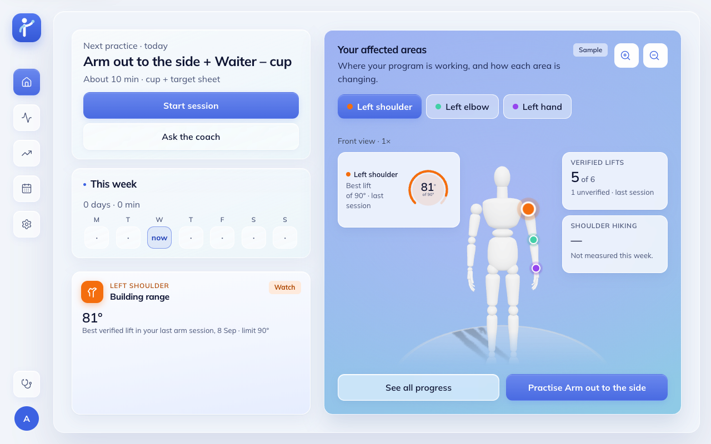
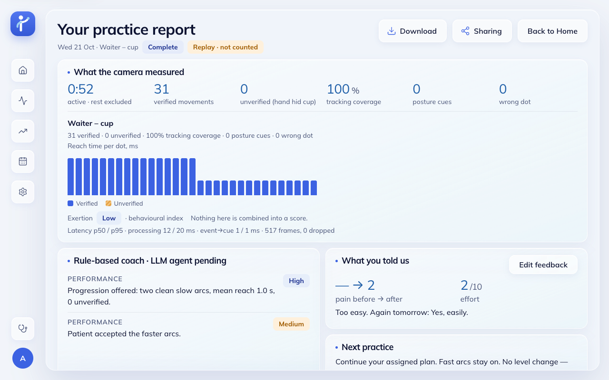
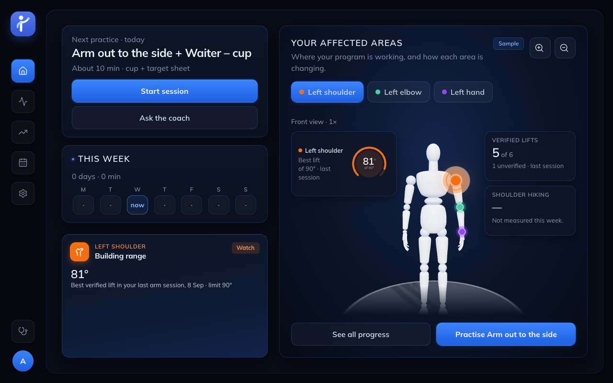
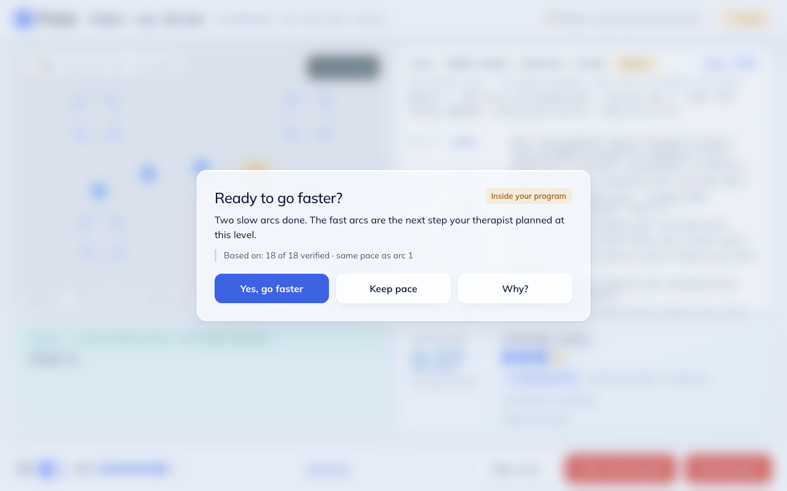
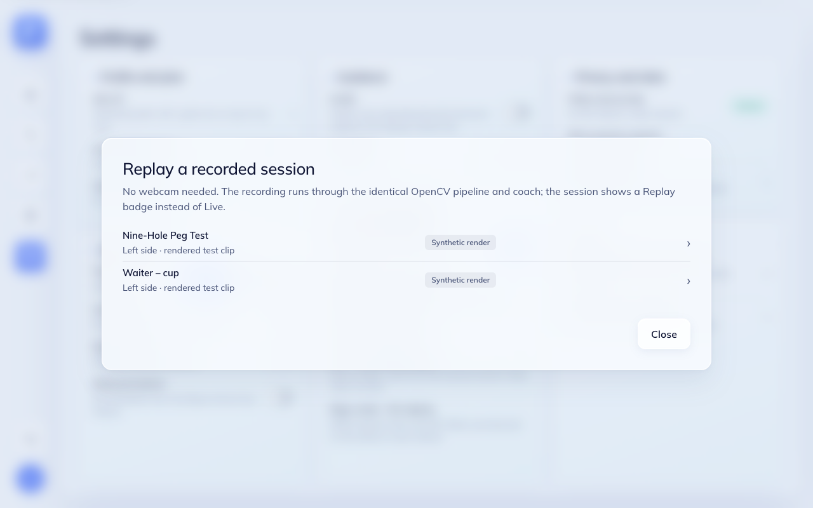
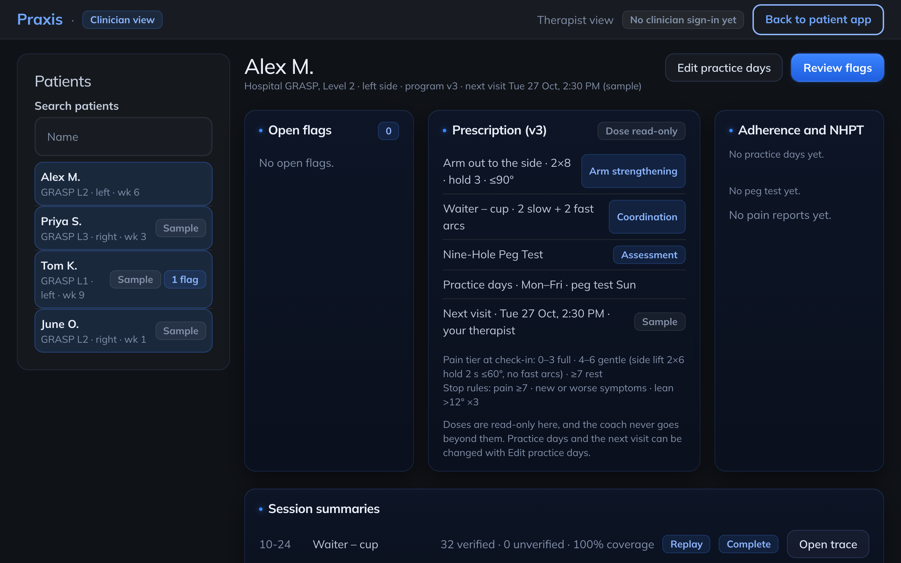

<h1 align="center">Praxis</h1>

<p align="center"><b>An agentic vision coach for arm and shoulder rehab at home, for exercises a therapist has prescribed. One laptop camera, a printed sheet, OpenCV 5.</b></p>

<p align="center">
  
  
  
  
  
  
</p>

Praxis helps people do the upper-limb (shoulder, arm and hand) exercises their therapist prescribed, at home. The patient works in front of a laptop's built-in camera with a printed A4 sheet and a cup or a few pegs. OpenCV 5 checks each repetition and a coach gives short cues that stay inside the prescription. To try it, open the live build at https://d235zashbh751z.cloudfront.net or follow our five-minute [`docs/JUDGE_QUICKSTART.md`](docs/JUDGE_QUICKSTART.md).

Safety comes first: hard-coded stop rules check every event before the coach sees it. There are two coaches. One is a deterministic rule coach. The other is an optional Claude agent that calls OpenCV tools over MCP (Model Context Protocol, a standard way for an AI model to call tools). There are three exercises: **Arm out to the side** (shoulder abduction), **Waiter – cup** (a GRASP coordination task) and the **Nine-Hole Peg Test (NHPT)** (a weekly assessment). This is Team Praxis' entry in the OpenCV AI Competition 2026 (powered by AWS).

> Praxis is an adherence and coaching aid. **It is not a medical device.** The therapist prescribes, the coach suggests changes inside that prescription, and the stop rules in code always win. Video is processed in memory and is never stored by default.

<table>
  <tr>
    <td width="33%"></td>
    <td width="33%"></td>
    <td width="33%"></td>
  </tr>
  <tr>
    <td><sub><b>Home</b> · body map on the mannequin (sample data)</sub></td>
    <td><sub><b>Demonstration</b> · Arm out to the side, 90° ceiling</sub></td>
    <td><sub><b>Waiter – cup</b> · Replay of a synthetic clip: OpenCV overlay, coach caption, verified / unverified counts</sub></td>
  </tr>
  <tr>
    <td></td>
    <td></td>
    <td></td>
  </tr>
  <tr>
    <td><sub><b>Nine-Hole Peg Test</b> · Replay: Hough holes, peg occupancy, timer and splits</sub></td>
    <td><sub><b>Show trace</b> (judge view) · OpenCV event → decision → action</sub></td>
    <td><sub><b>Session report</b> · verified vs unverified, no composite score</sub></td>
  </tr>
</table>

<details>
<summary>More screens: dark theme, progression prompt, Replay picker, therapist view</summary>

<table>
  <tr>
    <td width="50%"></td>
    <td width="50%"></td>
  </tr>
  <tr>
    <td><sub>Home, dark theme</sub></td>
    <td><sub>Progression prompt: the coach suggests a change inside the prescription and the patient decides</sub></td>
  </tr>
  <tr>
    <td></td>
    <td></td>
  </tr>
  <tr>
    <td><sub>Replay picker (Settings → Demo and judging); the clips are synthetic renders</sub></td>
    <td><sub>Therapist view (read-only, sample data)</sub></td>
  </tr>
</table>

</details>

We took these screenshots at 1280 × 800 with no webcam. The sessions are **Replay** runs of synthetic clips through the same pipeline. Home and the therapist view show the built-in sample data.

## Why it matters

From [`docs/TECHNICAL_REPORT.md`](docs/TECHNICAL_REPORT.md) §1 (the references are listed there):

- Arm problems after a stroke are common and they last. More than 70 % of people who have a stroke have upper-limb deficits [2]. In a group of 102 patients with arm paresis (weakness), only 11.6 % had their arm fully recover its function at six months [3].
- Recovery needs more repetitions than clinic time gives. Across 312 observed therapy sessions, task-specific arm practice happened in only 51 % of them, and averaged 32 repetitions when it did [5]. The rest is meant to happen at home, where up to 70 % of people do not stick to their self-managed physical therapy [6].
- Home programs work when people do them, but at home there is no feedback. GRASP is an arm program people do on their own. In a trial of 103 stroke inpatients, it improved arm function by 6.2 CAHAI points (an arm and hand activity scale) more than an education control [2]. At home, nobody checks how well a rep was done or how much to do on a bad day, and the therapist does not hear about it until the next visit.

## Try it

- **Live: https://d235zashbh751z.cloudfront.net** (AWS Graviton4 c8g with COOL OpenCV, over HTTPS). We stop the instance between work sessions. It is started for judging from 24 Oct and kept up through 10 Nov 2026 (judging ends 10 Nov, 2:45 am EST). `/health` shows `opencv_build.cool: true` and `arch: aarch64`.
- Where to start: on Home, the next-practice card is marked **Start here**. Start session walks you through each step. You can reach everything else from the left menu.
- It starts empty. A fresh install has no history, so every number on Home, Progress and the therapist view comes from sessions run on it. The made-up sample history (patient "Alex M.", September sessions, labelled Sample) loads only with `PRAXIS_SAMPLE_HISTORY=1`.
- No webcam? Go to Settings → Demo and judging → **Replay a recorded session**. It runs a recorded clip through the same pipeline (labelled "Replay"; the clips are synthetic renders).
- Five-minute walkthrough: [`docs/JUDGE_QUICKSTART.md`](docs/JUDGE_QUICKSTART.md).

## How it works



This diagram is exported from [`docs/ARCHITECTURE.md`](docs/ARCHITECTURE.md) §1. Dashed boxes are planned and not built.

<p align="center"></p>

Here is one real agent run (Claude Sonnet 5.5, synthetic frames, 21 Oct). `check_setup` reports that the cup is not seen, so the agent re-samples the cup colour. OpenCV then detects the cup, the resume prompt passes a fresh check, and the next reach is verified. The rule coach on its own never re-samples the cup. Every value is copied line by line from the trace in [`docs/AGENT.md`](docs/AGENT.md).

Built with: OpenCV 5 (`cv2.aruco` + `findHomography` sheet calibration, `HoughCircles`, HSV `inRange` + `findContours`, masked `matchTemplate`, OpenCV Zoo hand and pose ONNX models via `cv2.dnn`) · FastAPI · React + TypeScript + Three.js · Strands Agents + FastMCP · Claude via the Anthropic API · AWS EC2 Graviton4 (c8g) from the COOL AMI behind CloudFront.

## Headline results

| What | Result | Evidence |
|---|---|---|
| Arm angle on **real video** (REHAB24-6, a public lab dataset: 8 healthy adults facing the camera, 88 reps) vs motion capture | angle MAE (mean absolute error) 3.8°, rep-peak MAE 3.8°, rep F1 0.93 | [`evaluation/results/rehab24_v0.md`](evaluation/results/rehab24_v0.md), [`rehab24_thresholds_v0.md`](evaluation/results/rehab24_thresholds_v0.md) |
| COOL vs the stock OpenCV wheel, same c8g.large (11 Oct) | 1.2–1.6× faster on HSV threshold, contours, Hough and template matching. Full classical frame: 1.03× (NHPT) and 0.94× (cup). Slower on decode, ArUco, warp and the DNN | [`benchmark/results/cool_vs_stock_c8g.md`](benchmark/results/cool_vs_stock_c8g.md) |
| Claude agent (Sonnet 5.5, Anthropic API) on **real video** (REHAB24-6 run through the product pipeline, 40 sessions, simulated taps) | Corrected a fault (confirmed by motion capture) in 41/44 set reviews. Named the fix on 26/26 wrong-view pauses. 0 guardrail violations. First action p50/p95 3.7/5.8 s. $0.050 per session | [`evaluation/results/agent_video_v0.md`](evaluation/results/agent_video_v0.md) |
| Claude agent on synthetic scenarios (21 Oct recheck of the 15 plumbing scenarios, current build) | 15/15, 0 guardrail violations. The suite now has 16: the new `mixed_signals` judgement scenario **fails 0/3** on Sonnet 5.5. This is an open finding ([`docs/AGENT.md`](docs/AGENT.md)) | [`agent_recheck_2026-10-21_all.md`](evaluation/results/agent_recheck_2026-10-21_all.md), [`agent_recheck_2026-10-21_mixed_signals_x3.md`](evaluation/results/agent_recheck_2026-10-21_mixed_signals_x3.md) |
| Nine-Hole Peg Test and Waiter – cup | **Synthetic only.** We have no real-camera accuracy number. Pipeline checks on renders (NHPT rep F1 1.0, cup reach F1 0.984), a 107-condition robustness sweep, 3-D renders | [`dataset_v0.md`](evaluation/results/dataset_v0.md), [`robustness_v0.md`](evaluation/results/robustness_v0.md), [`synthetic3d_v0.md`](evaluation/results/synthetic3d_v0.md) |

## Run it locally (edge mode, no frame leaves the laptop)

```bash
cd services/session && uv sync && uv run python tools/fetch_models.py    # Python 3.12 + uv; Apache-2.0 OpenCV Zoo ONNX models
uv run uvicorn praxis_session.main:app --port 8000                        # → http://127.0.0.1:8000/health
cd ../../web && pnpm install && pnpm dev                                   # → http://localhost:5173
```

Print the sheets at 100 % first: [`docs/sheets/nhpt_board.pdf`](docs/sheets/nhpt_board.pdf), [`docs/sheets/cup_targets.pdf`](docs/sheets/cup_targets.pdf). The agent coach stays off unless you set `PRAXIS_AGENT=anthropic` and an API key (see [Agent coach](#agent-coach-claude--opencv-tools-over-mcp-optional)). More commands are below.

## Honest limits

- We only have real-video accuracy for **Arm out to the side**, and only on healthy adults in a motion-capture lab, not patients at a laptop. We did not record our own sessions.
- **NHPT and Waiter – cup are only validated on synthetic renders.**
- Angles are estimates relative to the camera, not goniometry (clinical joint-angle measurement). The printed peg sheet is a timing aid, not the clinical instrument.
- There was no usability (SUS) study and no patients. We did a team shake-down on the hosted build: 15 live sessions, 4 testers, including automated agent-driven sessions. It was a team shake-down, not a usability study ([`evaluation/results/team_test_2026-10-21.md`](evaluation/results/team_test_2026-10-21.md)).
- On AWS we use EC2 + COOL + CloudFront. S3 and CDK are not built. CloudWatch is built but not yet verified on AWS. The agent runs on Claude via the Anthropic API; Bedrock is not used.
- The hosted build has no sign-in and holds sample data only.

Full list: [`docs/TECHNICAL_REPORT.md`](docs/TECHNICAL_REPORT.md) §10 and [`docs/RISKS.md`](docs/RISKS.md).

## Docs map

| File | What it holds |
|---|---|
| [`docs/TECHNICAL_REPORT.md`](docs/TECHNICAL_REPORT.md) | The submission report: problem, users, architecture, OpenCV 5, coaching and agent, AWS + COOL, evaluation, responsible use, limitations |
| [`docs/JUDGE_QUICKSTART.md`](docs/JUDGE_QUICKSTART.md) | Five-minute guide to the live build and Replay |
| [`docs/ARCHITECTURE.md`](docs/ARCHITECTURE.md) | Mermaid diagrams: system, OpenCV pipeline per exercise, one agent loop |
| [`docs/AGENT.md`](docs/AGENT.md) | The Claude agent: tools, autonomy table, guardrails, model choice, cost |
| [`docs/ENGINEERING_NOTES.md`](docs/ENGINEERING_NOTES.md) | Module-by-module detail and the dated build changelog |
| [`docs/ACCESSIBILITY.md`](docs/ACCESSIBILITY.md) | WCAG 2.1 AA audit, exceptions, what is not served |
| [`docs/LICENSES.md`](docs/LICENSES.md) | Models, datasets, fonts, libraries, GRASP attribution |
| [`docs/RISKS.md`](docs/RISKS.md) | Running risk log |
| [`docs/PLAN.md`](docs/PLAN.md) · [`docs/SUBMISSION_CHECKLIST.md`](docs/SUBMISSION_CHECKLIST.md) | Build plan · what is done for submission |
| [`evaluation/PROTOCOL.md`](evaluation/PROTOCOL.md) | Protocol for our own recordings (built, not run) |
| [`infra/ec2/README.md`](infra/ec2/README.md) | AWS deploy (one script), start/stop, CloudWatch setup |
| [`video/README.md`](video/README.md) | Video kit: captures and slides |

## Developer reference

Everything below is for running, testing and deploying the code.

### Full local commands (edge / laptop mode)

<details>
<summary>Show the commands (print sheets, service, web app, Replay, evaluation, recordings)</summary>

```bash
# 0. Print the sheets at 100 % (A4 or US Letter). Check the scale bar measures 80 mm.
#    docs/sheets/nhpt_board.pdf · docs/sheets/cup_targets.pdf

# 1. Session service (Python 3.12 + uv). fetch_models downloads the Apache-2.0 OpenCV Zoo ONNX files (25 MB).
cd services/session && uv sync && uv run python tools/fetch_models.py && uv run uvicorn praxis_session.main:app --port 8000
#    → http://127.0.0.1:8000/health  {"status":"ok","opencv_version":"5.0.0","mode":"edge"}

# 2. Web app (pnpm). No sign-in: the app opens straight on Home (`/` redirects to `/details`).
cd web && pnpm install && pnpm dev
#    → http://localhost:5173/details  Home (affected areas) → Start session → Choose → Demonstration → check-in · /demo?exercise=cup&side=left shows the demonstration
#    → http://localhost:5173/setup?exercise=nhpt  (Vite picks the next port if 5173 is busy)
#    Click Allow on the camera prompt. Lay the printed NHPT sheet flat 25–35 cm in front of the
#    laptop and tilt the screen forward until the whole sheet shows (laptop camera only):
#    the checklist turns Pass and "Continue to demonstration" unlocks.
#    → http://localhost:5173/session?hand=left            runs the Nine-Hole Peg Test live.
#      Pegs are found by colour. Bright pegs on a white sheet work out of the box; for wooden
#      or pale pegs, or a coloured/wooden board, seat one peg and tap that hole in the Board view
#      ("Tap a seated peg to sample its colour") — the service samples a 6 mm patch and uses a
#      ±12° hue window from then on (WebSocket command {"cmd":"sample_colour","hole":k}), or press
#      "Pegs not found? Tap a peg on the picture" and tap a peg on the camera view.
#    → http://localhost:5173/session?exercise=cup&side=left runs Waiter – cup (any cup: keep it beside the sheet until the four corners are found, then on dot 1;
#      it is found as what changed on the empty sheet; docs/sheets/cup_targets.pdf. A blue band still works, and for
#      a band colour: press "Cup not found? Tap the cup base on the picture" and tap it, or Enter
#      for the cup on its dot; sends {"cmd":"sample_colour","x_px":..,"y_px":..}. Black/grey/white is refused with the reason).
#    → http://localhost:5173/session?exercise=abduction&side=left runs Arm out to the side (face the camera,
#      no sheet needed). A link to a hidden exercise (pendulum, arm, external_rotation, ...) goes back to Choose.
#    → http://localhost:8000/api/plan?pain=5  today's plan at the gentle tier.
#
#    Socket form (ids in services/session/praxis_session/perception/exercises.py):
#    ws://localhost:8000/ws/session?mode=arm&exercise=abduction&tier=gentle&side=left

# 3. Replay mode (no webcam) — the judge fallback, identical pipeline
#    In the app: Settings → Demo and judging → "Replay a recorded session" → pick a clip.
#    A replayed session is saved as `source: replay`: listed with a Replay badge (Progress,
#    therapist view, report, Home), never counted in trends, practice totals, pain lists,
#    adherence or the NHPT trend.
#    From the CLI:
cd services/session
uv run python -m praxis_session.replay ../../evaluation/dataset_v0/synthetic_nhpt_01.mp4 --mode nhpt --quiet

# 4. Regenerate every evaluation number
uv run python ../../evaluation/scripts/make_dataset_v0.py && uv run python ../../evaluation/scripts/eval.py
uv run python ../../evaluation/scripts/latency.py --replay          # results/latency_v0.{md,json}
uv run python tools/fetch_rehab24.py                                 # REHAB24-6 arm abduction, ~0.55 GB, git-ignored, CC BY-NC (evaluation only)
uv run python ../../evaluation/scripts/rehab24_eval.py               # real video vs motion capture: results/rehab24_v0.{md,json}
uv run python ../../evaluation/scripts/rehab24_thresholds.py         # hike allowance + front-gate fit/held-out: results/rehab24_thresholds_v0.{md,json}
uv run python ../../evaluation/blender/make_dataset_3d.py            # 3-D Blender renders of NHPT + Waiter – cup (~35 min, Blender 5.2; clips git-ignored)
uv run python ../../evaluation/scripts/eval_3d.py                    # synthetic 3-D results: results/synthetic3d_v0.{md,json} (--use-cache: no clips needed)

# 5. Real recordings (step by step for the whole team: evaluation/PROTOCOL.md)
uv run python tools/record_session.py record                         # consented clip, git-ignored, 30-day deletion
uv run python tools/label_clip.py <clip.mp4> --labeller <initials>   # keyboard labeller
uv run python tools/dataset_v1.py manifest                           # labelled clips -> manifest
uv run python ../../evaluation/scripts/eval.py --dataset ../../evaluation/dataset_v1
uv run python ../../evaluation/scripts/sus.py                        # SUS questionnaire scores
uv run python tools/record_session.py purge-expired                  # daily: deletes clips past 30 days
```

</details>

Tests: `uv run pytest -q` and `uv run ruff check .` (session) · `pnpm test && pnpm typecheck && pnpm lint` (web).

#### Browser end-to-end check with a simulated camera

A real Chrome plays an OpenCV-rendered clip as if it were its webcam (`--use-file-for-fake-video-capture`). This way the whole path runs exactly as a judge sees it: camera setup → detection → session → coach → feedback → report, with no person and no printout. The clips show what a laptop camera sees of a printed sheet 25–35 cm in front of it (~40° tilt, upside down in the raw frame, sensor noise). They cover:

- the NHPT run
- Waiter – cup (2 slow + 2 fast arcs)
- the sheet leaving the view for 4 s
- a fingertip on one corner marker (setup)
- a hand over the two near corners mid-session (agent run)
- setups that are too dark, blurred or half out of frame

This is synthetic. It checks the product path, not real-world accuracy.

```bash
cd services/session && uv run python tools/make_fake_camera.py      # ~3 min, writes evaluation/fake_camera/ (git-ignored)
cd ../../web && pnpm build
cd ../services/session && PRAXIS_WEB_DIST=../../web/dist PRAXIS_DB=/tmp/praxis-e2e.db uv run uvicorn praxis_session.main:app --port 8100
cd ../../web && node scripts/e2e-fake-camera.mjs --origin http://127.0.0.1:8100 --out /tmp/praxis-e2e   # ~12 min
#   --only setup,arm,nhpt,cup,loss,replay (default) · agent (needs PRAXIS_AGENT=anthropic on the service: real model calls, a few cents) · --headed
```

It checks:

- the setup rows, and the hint the patient sees for each failure
- the overlay geometry against where the renderer put the sheet (and that the canvas mirrors with the video while the frames sent stay unmirrored)
- live counts, the timer and splits, and captions
- the trace and the latency line
- perception loss with pause and resume
- replay, and the report

Screenshots, the service's events for each run and `results.json` are saved in `--out`. The exit code is 1 when a check fails.

### Agent coach (Claude + OpenCV tools over MCP, optional)

This is off by default (`PRAXIS_AGENT=off`: rule coach only, exactly as before). When it is on, Claude Sonnet 5.5 (through Strands Agents) runs at checkpoints: check-in, the end of a set or arc, a stop-rule pause after unverified reps or lost tracking, the end of the peg test, and the end of the session. It calls OpenCV 5 tools served by FastMCP at `/mcp/perception`, `/mcp/exertion` and `/mcp/coach` (streamable HTTP, same port). Every dose change and every resume is a prompt the patient has to accept. Stop rules still run first. Details and the workflow diagram are in `docs/AGENT.md`.

```bash
cd services/session
cp .env.example .env              # set ANTHROPIC_API_KEY and PRAXIS_AGENT=anthropic (.env is git-ignored)
uv run uvicorn praxis_session.main:app --port 8000 --env-file .env
curl -s localhost:8000/health     # "agent": {"mode": "anthropic", "model": "claude-sonnet-5-5", "mcp": true, "ready": true, "runs_today": 0, "daily_runs_limit": 100}
PRAXIS_AGENT=scripted uv run uvicorn praxis_session.main:app --port 8000   # no key: canned tool calls, for UI work
uv run python ../../evaluation/scripts/agent_eval.py --planner scripted    # 16 scenarios (scripted passes 15; mixed_signals needs judgement), free (CI)
uv run python ../../evaluation/scripts/agent_eval.py --planner rule        # baseline: agent off; writes the ablation table
uv run python ../../evaluation/scripts/agent_eval.py --planner anthropic --yes   # real model, prints the cost first (add --repeat N)
curl -s localhost:8000/api/agent/metrics   # runs today, outcomes, errors, first-action p50/p95, cap
```

Agent results and why we chose this model: report §8.3 and [`docs/AGENT.md`](docs/AGENT.md). To run the agent on real video:

```bash
uv run python ../../evaluation/scripts/agent_video_eval.py --planner rule                    # real video, free (needs tools/fetch_rehab24.py)
uv run --env-file .env python ../../evaluation/scripts/agent_video_eval.py --planner anthropic --model claude-sonnet-5-5 --repeat 2 --yes   # ~$2.00 on Sonnet 5.5
```

### One-container deploy (Railway / any Docker host)

<details>
<summary>Show deploy details (single origin, team-test mode, therapist-only writes, Docker)</summary>

The image builds the web app and serves it from the session service. So the browser talks to **one origin** for the page, `/api`, `/health`, `/events` and the WebSocket (`/ws/session`). The build context is the repo root. Models are fetched (SHA256-pinned) at build time. The SQLite store lives in `/app/data` and does not persist unless a volume is mounted. `PORT` is honoured, and `railway.json` points Railway at the Dockerfile and the `/health` check.

**Team test (review build only).** With `PRAXIS_TEAM_TEST=1`, the app asks each browser once "Who's testing?" (a name, no password; **Skip** saves the sessions as `guest`) and saves every session under that name. `GET /api/review?format=md` (also in Settings › Demo and judging › Team test report) lists, for each exercise and tester:

- verified and unverified reps, and why
- tracking losses, and which marker or body part went missing
- stop rules that fired
- coach corrections
- the screen-08 answers

The most widespread problems come first (`praxis_session/review.py`). With the agent on (`PRAXIS_AGENT=anthropic`), an "AI coach" section reads each session's trace. It shows runs and outcomes, triggers, tools called and tools that failed (a guardrail refusal, for example a stale run or a dose already in force, is listed separately from a failure), MCP vs direct transport, errors (the rule coach takes over), dropped output, time from checkpoint to first action, tokens and an estimated cost. Only live sessions count; replays and the sample history do not. A session is stored only when its feedback arrives, so the review also counts live sockets that closed before that (close code, whether an agent run was in flight, seconds since the last agent run; trace row `socket_close`). On Railway the store sits on a volume at `/app/data`, so it survives redeploys. The service runs in US East (`us-east4-eqdc4a`); we moved it from Amsterdam on 13 Oct to cut live-frame lag. The flag is off by default and on in the judge build.

**Therapist-only writes (21 Oct).** There is no sign-in (Cognito is deferred). So the two therapist actions, Edit practice days (`PUT /api/prescription/schedule`) and Mark reviewed (`POST /api/flags/{id}/reviewed`), are guarded by `PRAXIS_THERAPIST_TOKEN`:

- If it is set, only a request carrying `X-Praxis-Therapist-Token: <token>` can write.
- If it is unset (the default), only a local request with no proxy headers can write (your laptop). Every request through Railway, CloudFront or the EC2 proxy gets 403, and the therapist screen shows "Therapist only … Nothing was changed".

To edit from a browser on a hosted build, set the token on the server and run `localStorage.setItem('praxis.therapistToken', '<token>')` in that browser's console. `/health` says which rule is active (`therapist_writes: token | local_only`). Reads and the patient's own writes (check-in, goal log, self-report, feedback edit) stay open.

```bash
docker build -f services/session/Dockerfile -t praxis .
docker run -p 8000:8000 praxis            # → http://127.0.0.1:8000/
```

You can also serve a build locally without Docker: `cd web && pnpm build`, then start uvicorn with `PRAXIS_WEB_DIST=../../web/dist`. This is still the **edge build** (`PRAXIS_CLOUD_ENABLED=0`, rule-based coach). If you host it remotely, webcam frames travel to the host over TLS, where they are processed in memory and thrown away, never stored. The AWS cloud mode is separate: Graviton4 c8g + COOL OpenCV behind CloudFront HTTPS (`infra/ec2/`, `docs/ENGINEERING_NOTES.md` §5).

</details>

### Static design preview (for designers; not the product)

`cd web && pnpm build:design` (optionally `--outDir <dir>`) builds a click-through copy of the app into `web/dist-design/`. It needs **no service and no camera**. It uses relative asset URLs, hash routing and unminified output. Only `--mode design` includes `src/designPreview/`; `pnpm build` is unchanged.

Every screen reads fixtures captured from the live service (`node scripts/capture-design-fixtures.mjs`). Sessions replay recorded event streams. For NHPT and Waiter – cup, these are the synthetic replay clips recorded over the service's WebSocket. For Arm out to the side and Camera setup, they come from the service's pipeline run offline on synthetic input (`uv run python ../../web/scripts/record-design-streams.py` from `services/session`). The camera shows a labelled placeholder, and every page has a "Design preview · sample data · no camera" tab. Nothing is measured or stored. Writes (flag reviewed, schedule edit, check-in) live in page memory until you reload.

### Layout

```
services/session/   FastAPI + OpenCV 5 + stop rules + coach (one process)
web/                React + TS + Vite, Radix + Tailwind 4, Three.js avatar
infra/ec2/          AWS deploy script, systemd unit, CloudWatch setup (no CDK app)
evaluation/         dataset, scripts, results
benchmark/          COOL vs stock OpenCV harness + results (11 Oct)
traces/             coach JSON traces
video/              video kit: capture script, slides
docs/               TECHNICAL_REPORT.md (submission), JUDGE_QUICKSTART.md, ARCHITECTURE.md, AGENT.md, ENGINEERING_NOTES.md, ACCESSIBILITY.md, LICENSES.md, RISKS.md, PLAN.md, sheets/, wireframes/, img/
```

## Team

Team Praxis: Rinky · Shruthi · Sathvik

## License

Third-party models, datasets, fonts and GRASP attribution: [`docs/LICENSES.md`](docs/LICENSES.md).

We paraphrased the GRASP ideas from UBC / Heart & Stroke material and drew our own illustrations. The real-motion avatar clips come from UI-PRMD (Vakanski et al. 2018, ODC PDDL 1.0) and IntelliRehabDS (Miron et al. 2021, CC BY 4.0). Only the derived joint angles are in the repo.

Praxis code is released under the [MIT License](LICENSE). Third-party models, datasets, fonts and GRASP material keep their own terms.
