<p align="center">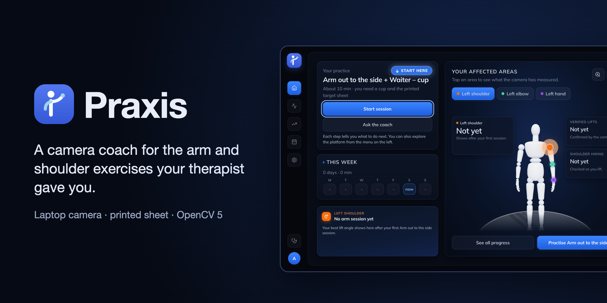</p>

<p align="center">
  
  
  
  
  
  
</p>

<p align="center">
  <a href="https://d235zashbh751z.cloudfront.net">Try it live</a> ·
  <a href="#how-it-works">How it works</a> ·
  <a href="#results">Results</a> ·
  <a href="#where-it-fails">Where it fails</a> ·
  <a href="#run-it-yourself">Run it yourself</a>
</p>

<p align="center">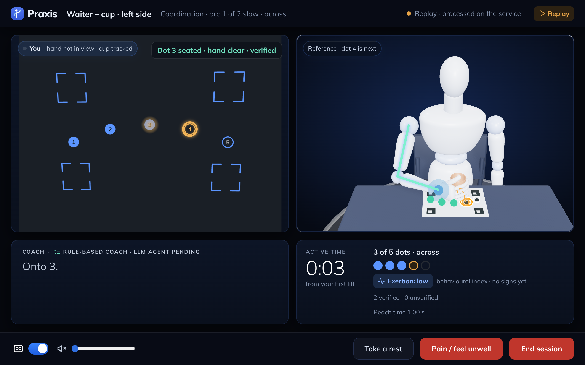</p>

- **Live app:** <https://d235zashbh751z.cloudfront.net> (AWS Graviton4 with COOL). No webcam? Settings → **Replay a recorded session**.
- **Five-minute guide:** [docs/JUDGE_QUICKSTART.md](docs/JUDGE_QUICKSTART.md)
- **Technical report:** [docs/TECHNICAL_REPORT.md](docs/TECHNICAL_REPORT.md), also as [PDF](docs/Praxis_Technical_Report.pdf)
- **Diagrams:** [docs/ARCHITECTURE.md](docs/ARCHITECTURE.md) · **Evaluation:** [evaluation/README.md](evaluation/README.md)

Praxis helps people do the shoulder, arm and hand exercises their therapist prescribed. There are three: **Arm out to the side**, **Waiter – cup** (moving a cup across five printed dots) and the **Nine-Hole Peg Test** (a weekly timed test). OpenCV 5 checks each rep from the laptop camera. Hard-coded safety rules check every event first. Then a coach gives a short cue that stays inside the prescription.

> Praxis is an adherence and coaching aid. **It is not a medical device.** The therapist prescribes, the coach suggests changes inside that prescription, and the safety rules in code always win. Video is processed in memory and never stored.

## Why it matters

- More than 70 % of people who have a stroke have arm problems, and in one group of 102 patients only 11.6 % got full arm function back at six months.
- Recovery needs many repetitions. In 312 observed therapy sessions, arm practice happened in half of them, about 32 reps each time. The rest is meant to happen at home, where up to 70 % of people don't keep up their exercises.
- At home nobody checks how well a rep was done or how much to do on a bad day, and the therapist only hears about it at the next visit.

Sources: [report §1](docs/TECHNICAL_REPORT.md).

## How to use it

<table>
  <tr>
    <td width="33%">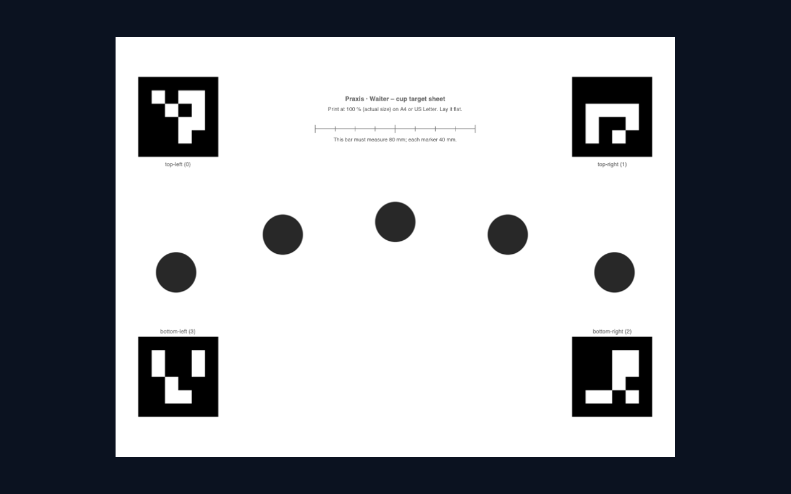</td>
    <td width="33%">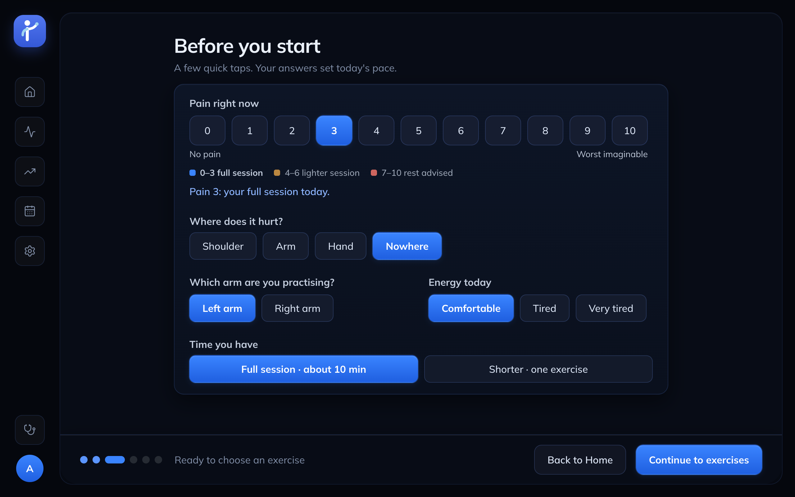</td>
    <td width="33%">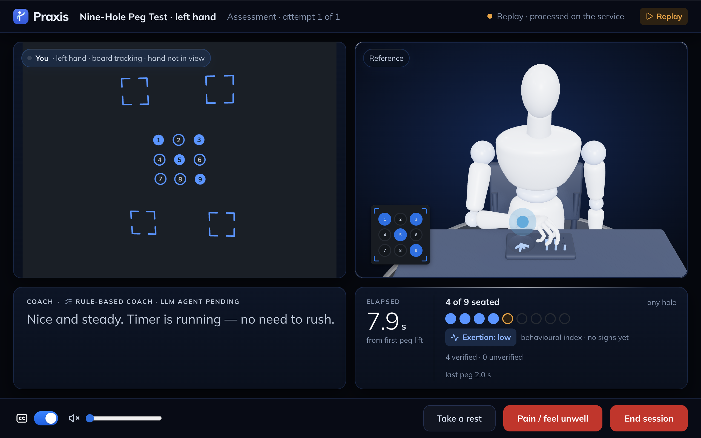</td>
  </tr>
  <tr>
    <td><b>1. Print a sheet</b><br><sub>Lay it flat in front of the laptop and tilt the screen until the four corners show.</sub></td>
    <td><b>2. Say how you feel</b><br><sub>Your pain sets today's dose. 7 or more: rest is advised and your therapist is told.</sub></td>
    <td><b>3. Do the exercise</b><br><sub>OpenCV checks each rep. Anything it could not see is counted as unverified, never as a fail.</sub></td>
  </tr>
</table>

## How it works

<table>
  <tr>
    <td width="33%">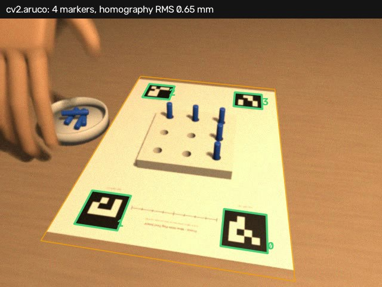</td>
    <td width="33%">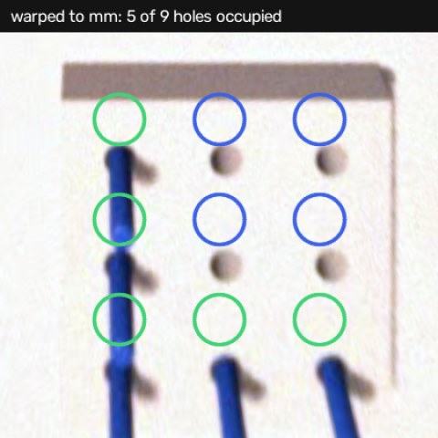</td>
    <td width="33%">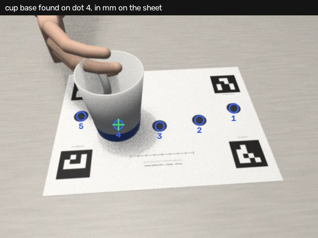</td>
  </tr>
  <tr>
    <td valign="top"><b>Sheet → millimetres</b><br><sub>Four printed markers give the homography from camera pixels to millimetres on the sheet. Nothing starts until all four are seen.<br><code>cv2.aruco</code> · <code>findHomography</code><br><a href="services/session/praxis_session/perception/calibration.py">calibration.py</a></sub></td>
    <td valign="top"><b>Pegs in holes</b><br><sub>The board is warped flat, holes found once, and each hole read as empty or occupied from peg colour and change from the empty board. A timer runs from first lift to ninth peg.<br><code>warpPerspective</code> · <code>HoughCircles</code> · <code>inRange</code> · <code>findContours</code> · <code>matchTemplate</code><br><a href="services/session/praxis_session/perception/board.py">board.py</a> · <a href="services/session/praxis_session/perception/peg_fsm.py">peg_fsm.py</a></sub></td>
    <td valign="top"><b>Cup on the dots</b><br><sub>The cup base is what changed on the empty sheet. A rep counts when it lands on the next dot; the reach time is measured per dot.<br><code>warpPerspective</code> · <code>findContours</code> · <code>convexHull</code> · <code>moments</code><br><a href="services/session/praxis_session/perception/cup.py">cup.py</a></sub></td>
  </tr>
  <tr>
    <td>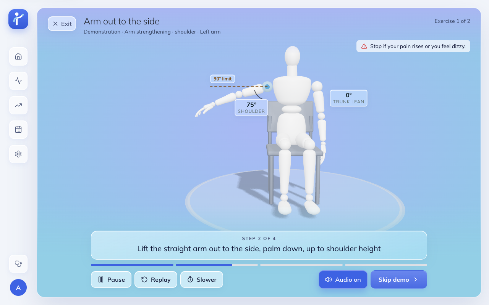</td>
    <td>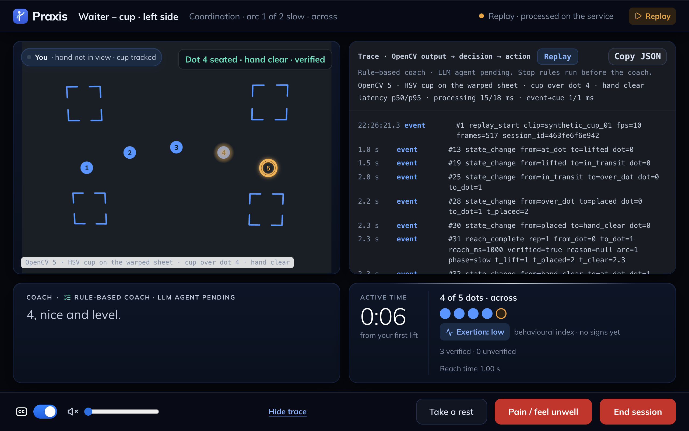</td>
    <td>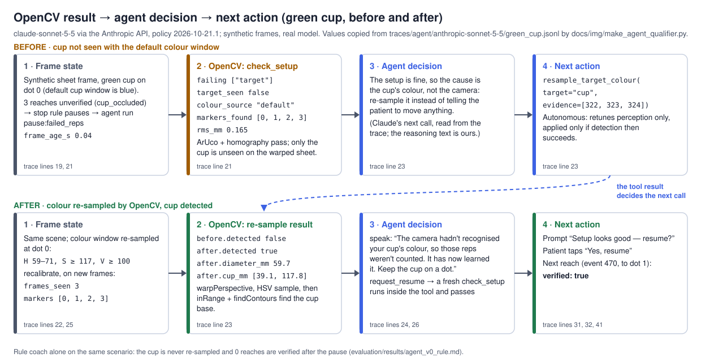</td>
  </tr>
  <tr>
    <td valign="top"><b>Arm angle</b><br><sub>The OpenCV Zoo pose model gives the shoulder angle (smoothed; the target is capped at 90°) and flags leaning or a hiked shoulder when the hips are in view. The mannequin only shows the move; it never scores.<br><code>cv2.dnn</code><br><a href="services/session/praxis_session/perception/pose.py">pose.py</a> · <a href="services/session/praxis_session/perception/arm_fsm.py">arm_fsm.py</a></sub></td>
    <td valign="top"><b>Safety rules first, then the coach</b><br><sub>Pain, repeated leaning, repeated missed or unverified reps, or losing you on camera pause or stop the session and flag the therapist, before any coach sees the event. Every cue traces back to an OpenCV event.<br><a href="services/session/praxis_session/stop_rules.py">stop_rules.py</a> · <a href="services/session/praxis_session/coach/rules.py">coach/rules.py</a></sub></td>
    <td valign="top"><b>Our agent (optional)</b><br><sub>Claude Sonnet 5.5 runs at checkpoints and calls OpenCV tools over MCP. It gets numbers and short text, never frames. Every dose change is a prompt the patient accepts.<br><a href="services/session/praxis_session/agent/tools.py">agent/tools.py</a> · <a href="docs/AGENT.md">AGENT.md</a></sub></td>
  </tr>
</table>

<sub>The top three pictures are 3-D Blender renders run through the real OpenCV code (<a href="docs/img/make_pipeline_figs.py">make_pipeline_figs.py</a>), not a real camera.</sub>

## Prizes we're entering

| Prize | What it asks for | Where we show it |
|---|---|---|
| **Overall Awards** | OpenCV 5 doing real image analysis, and a meaningful part running on AWS | The whole entry, live on AWS |
| **Best Use of COOL** · $1,000 | COOL running the core workload on AWS Graviton | The session service on EC2 c8g.large (Graviton4) from the COOL AMI. Its `/health` says `opencv_build.cool: true`. [Benchmark](benchmark/results/cool_vs_stock_c8g.md) |
| **Agentic Vision** · $1,000 | An agent using OpenCV tools, where what OpenCV sees changes its next action | Our agent's loop below, and a real trace in [docs/AGENT.md](docs/AGENT.md) |

### Architecture 1: the system on AWS with COOL

<p align="center">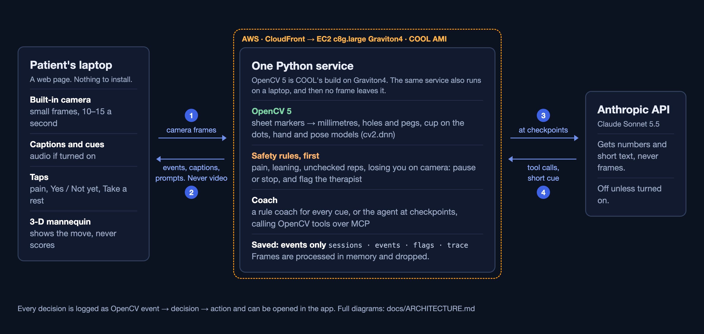</p>

### Architecture 2: our agent's loop

<p align="center">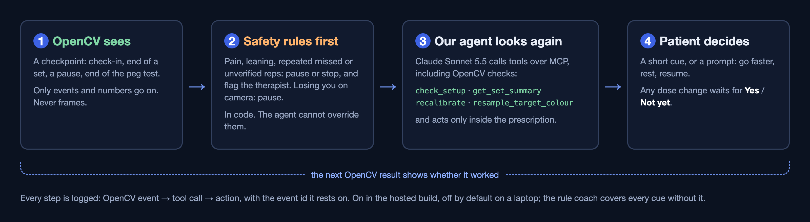</p>

The detailed diagrams (OpenCV steps per exercise, one full agent run) are in [docs/ARCHITECTURE.md](docs/ARCHITECTURE.md).

## Results

| What | Result | Evidence |
|---|---|---|
| Arm angle on **real video** (REHAB24-6, a public lab dataset: 8 healthy adults, 88 reps) vs motion capture | angle error (MAE) 3.8°, rep F1 0.96 | [rehab24_v0.md](evaluation/results/rehab24_v0.md) |
| Same videos cropped to **laptop framing** (hips at or below the bottom edge) | rep F1 0.91–0.93 (34–35 of 35 reps found), angle error 5.0–7.5°. Before our 25 Oct fix: F1 0.28–0.76 | [rehab24_laptop_framing_v0.md](evaluation/results/rehab24_laptop_framing_v0.md) |
| Our agent (Sonnet 5.5) on **real video** (REHAB24-6 through the product, 40 sessions, 12 Oct run) | Named a fault that motion capture confirmed, and gave a correction, in 41 of 44 set reviews (patient taps simulated); 0 guardrail breaks; first action 3.7 s median; about $0.05 a session | [agent_video_v0.md](evaluation/results/agent_video_v0.md) |
| Our agent on 15 synthetic test scenarios | 15 of 15 pass. One newer, harder case (mixed signals) **fails in all 3 runs**; it is still open | [AGENT.md](docs/AGENT.md) |
| Nine-Hole Peg Test and Waiter – cup, **live on real webcams** (our team, laptop camera, 13–24 Oct) | Found real bugs the renders missed, fixed and re-tested on renders, not yet re-tested live: plain wooden pegs and an ordinary cup not seen, a hand over the board counted as pegs (1 real peg read as 9), cup counts lagging 5–23 s. Speed in 4 real cup sessions: camera to result in 132–147 ms (median), network included. No stopwatch-checked accuracy yet | [report §8.1.1](docs/TECHNICAL_REPORT.md) · [live_sessions_2026-10-24.md](evaluation/results/live_sessions_2026-10-24.md) |
| Nine-Hole Peg Test and Waiter – cup, **measured** on 3-D Blender renders | Computer-made 3-D videos, not real people. Peg test: F1 0.97, total time off by 1.2 s on average; most seats (90 of 96) are counted but marked unverified (grasp not seen). Cup: F1 0.79, reach time off by 0.7 s | [synthetic3d_v0.md](evaluation/results/synthetic3d_v0.md) |
| COOL vs stock OpenCV, same c8g.large (measured 11 Oct) | 1.2–1.6× faster on colour threshold, contours, Hough and template matching; 10–16 % slower on JPEG decode, ArUco, warp and the hand model; about even on a full frame | [cool_vs_stock_c8g.md](benchmark/results/cool_vs_stock_c8g.md) |

## Where it fails

- Measured real-video accuracy exists only for **Arm out to the side**, and only on healthy adults in a lab. We store no video, so our own live sessions have no labelled ground truth.
- **The peg test and cup have no stopwatch-checked real number yet.** On the 3-D renders the cup still misses about a third of reaches, almost all in a dim room and at a very flat 20° screen tilt; the failures are listed in [synthetic3d_v0.md](evaluation/results/synthetic3d_v0.md).
- With the hips out of view, Arm out to the side still counts reps, but it cannot check shoulder hiking or leaning, and the angle is less accurate.
- Angles are relative to the camera, not clinical goniometry. The printed peg sheet is a timing aid, not the clinical instrument.
- No usability (SUS) study and no patients. Our own testing was 17 saved live sessions by 3 of us (13–24 Oct) plus 7 automated runs; the 21 Oct snapshot is in [team_test_2026-10-21.md](evaluation/results/team_test_2026-10-21.md).
- On AWS we use EC2 (COOL AMI) and CloudFront. S3 storage and a one-command CDK deploy are not built, and the hosted app has no sign-in.

Full list: [report §10](docs/TECHNICAL_REPORT.md) and [docs/RISKS.md](docs/RISKS.md).

## Run it yourself

```bash
cd services/session && uv sync && uv run python tools/fetch_models.py   # Python 3.12 + uv, OpenCV Zoo models
uv run uvicorn praxis_session.main:app --port 8000                       # → http://127.0.0.1:8000/health
# in a second terminal, from the repo root
cd web && pnpm install && pnpm dev                                        # → http://localhost:5173
```

Print [the peg sheet](docs/sheets/nhpt_board.pdf) or [the cup sheet](docs/sheets/cup_targets.pdf) at 100 %. No webcam: Settings → Replay a recorded session. Tests: `uv run pytest -q` (service) and `pnpm test` (web). Agent, evaluation, Docker and deploy commands: [docs/DEVELOPING.md](docs/DEVELOPING.md).

## Repo map

```
services/session/   FastAPI + OpenCV 5 + safety rules + coach + agent tools (one process)
web/                React + TypeScript web app, Three.js mannequin
evaluation/         datasets, scripts that regenerate every number, results
benchmark/          COOL vs stock OpenCV
infra/ec2/          AWS deploy script and CloudWatch setup (CloudWatch not yet run on AWS)
docs/               report (+ PDF), quickstart, diagrams, agent, licences, risks, sheets
traces/             sample coach traces: OpenCV event → decision → action
video/              slides and notes for the submission video
```

## Team

Team Praxis: Rinky · Shruthi · Sathvik

## License

Praxis code is MIT ([LICENSE](LICENSE)). Models, datasets, fonts and GRASP material keep their own terms: [docs/LICENSES.md](docs/LICENSES.md). GRASP ideas from UBC / Heart & Stroke are paraphrased with our own illustrations.
