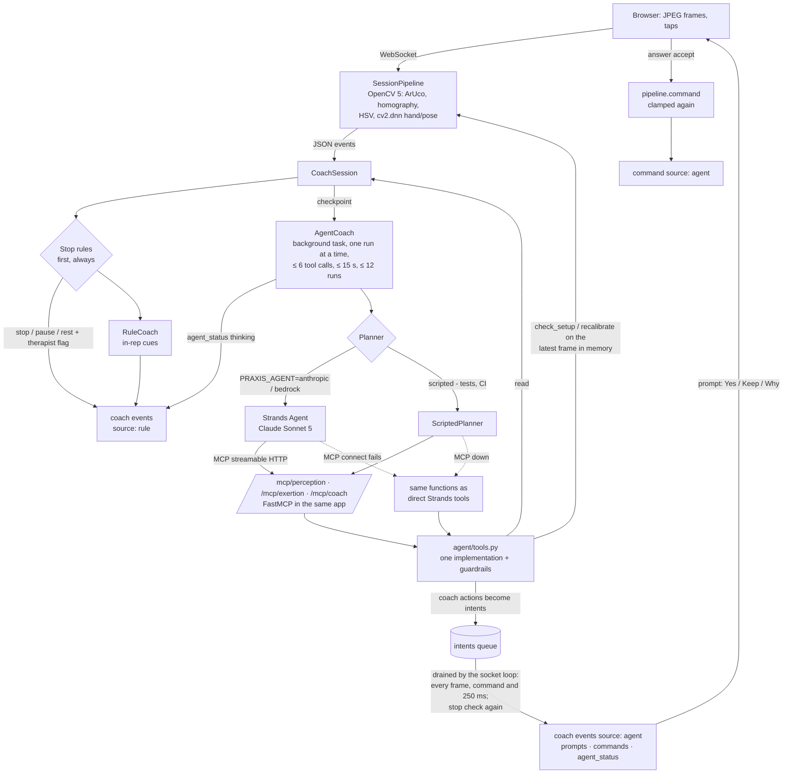

# Agent coach — how it works

Design: `docs/superpowers/specs/2026-09-29-agent-coach-design.md` (approved 29 Sep 2026). Service code: `services/session/praxis_session/agent/` (tools, MCP servers, model/planners) and `coach/agent.py` (AgentCoach). Built 29 Sep with a scripted planner; **run against real Claude (Sonnet 5, Anthropic API, dev) on 10 Oct 2026**: 9/9 scenarios on each of four consecutive full runs with the final prompt, 0 guardrail violations (`evaluation/results/agent_v0_anthropic.md`). Bedrock is configured but not yet run (no working AWS credentials).

## What it is

A hybrid coach. The deterministic rule coach keeps every in-rep cue (instant, offline). At **checkpoints** Claude (Sonnet 5, via Strands Agents) runs a short perceive → decide → act → re-perceive loop with **OpenCV 5 tools**, and anything that changes the session becomes a **prompt the patient must accept**. Stop rules run first, always, and nothing the agent does can override them.

| Checkpoint (trigger) | The agent's job |
|---|---|
| `checkin` | read the prescription (and history), one short opening line |
| `set_complete` (Arm out to the side) · `arc_complete` (Waiter – cup) | review the set: praise, correct, or propose a dose change |
| `pause:failed_reps` · `pause:perception` (stop-rule pauses) | setup recovery: `check_setup` → `speak` the specific fix → `recalibrate` → `request_resume` |
| `nhpt_complete` | explain the peg-test result plainly, no clinical claims |
| `feedback` (session end) | `write_session_summary` (a coach note in the report) |

## Workflow



## Tools (one implementation, three servers)

`agent/tools.py` holds every tool as a plain function; `invoke()` finds the session, enforces budgets, times the call, writes one `tool` trace row and checks that the result holds no pixels. The FastMCP servers (`agent/mcp_server.py`) and the direct Strands fallback wrap the same functions, so the guardrails are identical on every transport.

| Server | Tool | What it does |
|---|---|---|
| perception | `get_events(types?, last_n≤50)` | this session's recent non-frame events (ids are the evidence) |
| perception | `get_set_summary()` | last set/arc: reps, verified / missed / unverified with reasons, peaks, holds, lean/hike, reach times, previous set's mean peak |
| perception | `check_setup()` | **OpenCV now, on the latest frame in memory**: fresh `cv2.aruco` detection + `cv2.findHomography` (markers found/missing, reprojection error), `cv2.solvePnP` tilt, task area, lighting and sharpness, marker steadiness; person / joints / view for the arm |
| perception | `recalibrate()` | resets the calibrator (sheet tasks: four markers needed again) or the pose gate (arm), waits for the next frames, reports markers / rms mm / pose visible |
| exertion | `get_exertion_state()` · `get_prescription()` · `read_patient_model()` | behavioural exertion; dose + allowed adaptations + stop rules + what is running; short history (empty for a replay) |
| coach | `speak(text, cue, evidence)` | `instruct` / `correct`, ≤ 160 chars, one per 4 s (session clock) |
| coach | `propose_adjustment(exercise, field, value, reason, evidence)` | `progress` / `regress` **prompt** (Yes / Keep / Why); `target_deg`, `hold_s`, `reps` (arm), `phase` (cup); clamped with `prescription.clamp` |
| coach | `request_rest(seconds≤120, reason, evidence)` | `rest` |
| coach | `request_resume(reason, evidence)` | prompt "Setup looks good — resume?" (Yes / Not yet); only while a rule pause holds |
| coach | `flag_therapist(reason, evidence)` · `end_session(reason, evidence)` | therapist flag · `stop` + flag (can end, never extend) |
| coach | `write_session_summary(note ≤ 400, evidence)` | stored as `summary.coach.note` |

## Guardrails (code, not prompt)

- Coach tools only inside an agent run, never once the session is stopped, never from a stale run (the session stopped, resumed or ended since the checkpoint).
- `evidence` must list ids of events in **this session's** ring; otherwise the call is refused and nothing happens (CLAUDE.md rule 5).
- Dose changes are clamped to `allowed_adaptations` and are only prompts; the pipeline clamps again when the patient taps Yes. A resume is only a prompt. Decline changes nothing; "Why?" repeats the reason.
- One prompt at a time; ≤ 6 tool calls per run, ≤ 60 per session, ≤ 12 runs per session, 15 s per run.
- Outputs are queued and applied by the socket coroutine, which re-checks the stop: a pain stop mid-run drops everything the run queued (`agent_drop` trace row, run `outcome: stale`).
- Privacy: no tool result, trace row or model message holds pixels, frame bytes or base64 (`assert_no_pixels` on every result; tested). The latest frame is a reference in memory, overwritten by the next frame, never written.

## Failure handling

Model error, timeout, refusal or malformed call → trace `agent_error {error_kind, message}`, `agent_status offline` ("Coach offline · rule coach (…)"), the rule coach carries on, the next checkpoint retries and clears offline on success. MCP connection error → the run uses the direct tools (`agent_run.transport: direct`, `agent_error error_kind: mcp`). `PRAXIS_AGENT=off` → no agent, no MCP routes, the rule coach labelled "Rule-based coach · LLM agent pending", byte-for-byte as before. `PRAXIS_AGENT=anthropic` without a key → no agent runs; the socket sends `agent_status offline` with the reason and the rule coach is labelled "Rule-based coach".

## Configuration

| Env | Meaning |
|---|---|
| `PRAXIS_AGENT` | `off` (default) · `anthropic` · `bedrock` · `scripted` |
| `ANTHROPIC_API_KEY` | for `anthropic`; never logged or returned |
| `PRAXIS_AGENT_MODEL` | default `claude-sonnet-5` (effort `low`, `max_tokens` 800, no retries, no `thinking.budget_tokens`, no sampling params) |
| `PRAXIS_BEDROCK_MODEL_ID`, `AWS_REGION` | for `bedrock`, which also needs `PRAXIS_CLOUD_ENABLED=1` |
| `PRAXIS_MCP_URL` | where the agent reaches the MCP routes (default `http://127.0.0.1:$PORT/mcp`, `PORT` default 8000) |
| `PRAXIS_MCP=1` | mount the MCP routes with the agent off (read tools for an outside MCP client; coach actions still need an agent run) |

```bash
cd services/session
cp .env.example .env            # fill ANTHROPIC_API_KEY; .env is git-ignored
uv run uvicorn praxis_session.main:app --port 8000 --env-file .env
curl -s localhost:8000/health | jq .agent   # {"mode":"anthropic","model":"claude-sonnet-5","mcp":true,"ready":true}
```

## Contract with the web app

- `coach` events: the Decision fields plus `source: "rule" | "agent"` and `label` ("Rule-based coach · LLM agent pending" with the agent off, "Rule-based coach" otherwise; "Claude agent · Anthropic API (dev)" | "Claude agent · Amazon Bedrock" | "Claude agent · scripted (test)").
- `ui.prompt`: `{id, kind: progression | adjustment | resume, title, text, options, within_prescription, proposal?: {exercise, field, value, requested, clamped, unit}}`; answer `{"cmd": "answer", "prompt": id, "choice": option}`, option 0 accepts, option 1 declines.
- `agent_status {state: thinking | idle | offline, trigger?, reason?, label}`; `command {cmd: resume | set_target | set_hold | set_reps | set_phase | recalibrate, source: "agent"}`.
- `session_start {session_id, mode, exercise, label, agent}` right after connect (agent on only).
- Trace rows (`/api/trace`): `agent_run {phase, trigger, model, transport, ms, input_tokens, output_tokens, outcome, tool_calls, actions, first_action_ms, run}`, `tool {server, name, args, ok, ms, transport, result_summary, run}`, `agent_error {error_kind, message}` (`kind` is the row type), `agent_drop`, `coach_note`; `decide` / `action` rows carry `label` and `source` (the action verb is in `tool`).

## Evaluation

`evaluation/scripts/agent_eval.py`, scenarios in `evaluation/agent/scenarios/` (regenerate with `evaluation/agent/make_scenarios.py`). Scripted (CI): 9/9, 0 guardrail violations, `evaluation/results/agent_v0.md`, sample traces in `traces/agent/`. The scripted planner fixes the tool calls, so it validates tools, transport, guardrails, fallbacks and the approval path, not the model's judgement; `--planner anthropic --yes` is the model run (about 13 agent runs; the printed estimate is ~$0.94, the measured cost is ~$0.39 per full run at Sonnet 5 list price).

**Real Claude, 10 Oct 2026** (`evaluation/results/agent_v0_anthropic.{md,json}`, traces in `traces/agent/anthropic/`): task success 9/9, correct perception tool before every action 7/7, guardrail violations 0, fallback 2/2 (model timeout → rule coach; MCP down → direct tools), human approval respected 5/5, checkpoint → first action p50 / p95 ≈ 3.9 / 6.3 s, ~19.7k tokens per session. Repeated: four consecutive full runs with the final prompt were 9/9 each (36/36). The first runs that day were 7/9 and 8/9; the misses were prompt gaps, fixed in `agent/model.py` and `perception/quality.py` without changing any scenario expectation except one that was too weak (covered_marker now requires the spoken fix to name the **bottom-right** corner instead of matching any "2"):
- setup recovery now reads `get_set_summary` first, so a hand covering the cup (every setup check passing) is named as the cause instead of "everything looks good";
- compensation on most reps of a set (lean / hiking) → correct the form **and** propose a smaller target;
- `text` and `reason` are patient-facing: plain words, no "rms" or marker ids; setup hints name the sheet corner (`quality.corner_name`);
- `speak` cue: `instruct` for guidance and praise, `correct` only for a fault;
- the resume caption asks once (no "ready to continue? Ready to carry on?").

Known model behaviour (`docs/RISKS.md`): the resume reason can claim a fix the camera has not confirmed yet (dim_light: "Lighting adjusted…"); the agent praises after most clean arcs; first action takes ~4–6 s, so it never replaces the rule coach's in-rep cues.
