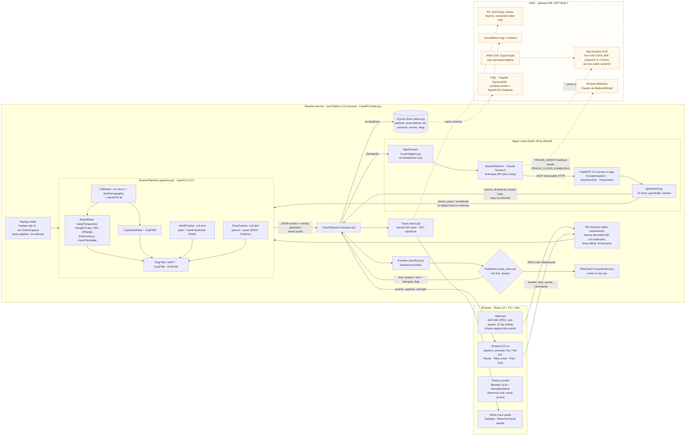
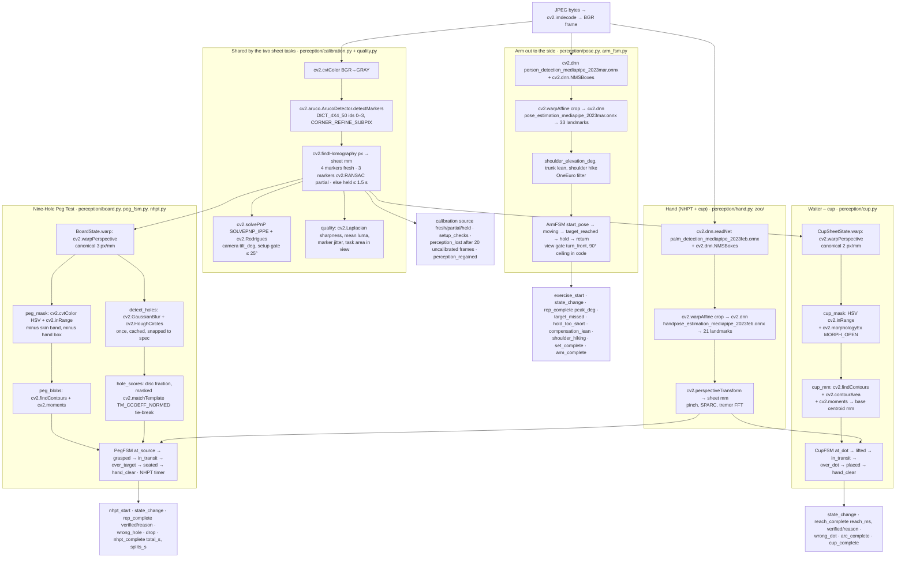
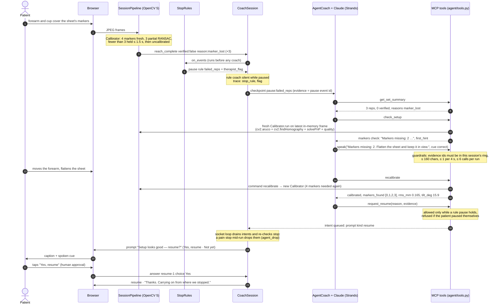

# Praxis — Architecture

Three diagrams for judges: (1) the whole system, (2) the OpenCV 5 pipeline per exercise, (3) one concrete agent loop where OpenCV output changes what the agent does next. Every module and function named here exists in `services/session/praxis_session/` as of 10 Oct 2026.

**Legend.** Solid boxes and arrows are built and tested. **Dashed boxes and arrows are planned for W6 (14–20 Oct) and do not exist yet**: there is no EC2 instance, no Bedrock run, no CDK app, no S3 bucket and no COOL benchmark. The `infra/`, `benchmark/` and `services/tools-lambda/` folders listed in `CLAUDE.md` §2 are not in the tree yet.

## 1. System architecture

**What runs where today.** Edge mode: everything above the AWS box runs on one laptop (`uv run uvicorn praxis_session.main:app`), or in one container (`services/session/Dockerfile`) hosted on Railway for team review. On the laptop no frame leaves the machine; on Railway frames travel over TLS to the container and are processed in memory and dropped (`docs/RISKS.md`, 17 Sep row). `PRAXIS_CLOUD_ENABLED` defaults to `0` and gates every cloud call; the `bedrock` planner refuses to start without it (`agent/model.py` `load_config`).

**Agent status.** The agent coach is built (29 Sep) and is off by default (`PRAXIS_AGENT=off`). It has been tested offline with `ScriptedPlanner` (CI) and, as of 10 Oct, is being run against real Claude through the Anthropic API (dev key). The Bedrock path (`BedrockModel`) is constructed and unit-tested but has never been called.

> **Real model (10 Oct 2026, Claude Sonnet 5 via the Anthropic API, dev):** 9/9 scenarios on each of four consecutive full runs, correct perception tool before action 7/7, 0 guardrail violations, fallback 2/2, human approval 5/5, checkpoint → first action p50 / p95 ≈ 3.9 / 6.3 s, ~19.7k tokens and ~$0.39 per full run (`evaluation/results/agent_v0_anthropic.md`, traces `traces/agent/anthropic/`). Bedrock not run yet.

## 2. OpenCV 5 pipeline per exercise

`SessionPipeline.process(frame_bgr, t, frame_index)` picks the mode the socket was opened with. Each mode returns one `frame` event per frame (overlay geometry in frame pixels, never pixels themselves) plus the state-machine events below. Module docstrings note `cv2.__version__` (5.0.0, `opencv-python-headless==5.0.0.93`).

Notes that keep the diagram honest:

- A rep the camera could not check is **unverified, not failed**: `reach_complete` with `cup_occluded` or `marker_lost`, NHPT `rep_complete` with `no_hand_near_hole`. Performance misses (`target_missed`, `hold_too_short`) are a separate count.
- Arm angles are image-plane, camera-relative progress numbers, **never goniometry**. Abduction from the front view cannot be told apart from a scaption-plane lift.
- Every threshold above was tuned on synthetic renders (`perception/synth.py`) and synthetic landmark streams. Real-camera accuracy is unmeasured until dataset v1 (`docs/PLAN.md` Phase 9).
- The hidden exercises (Pendulum, Arm to the front, Rotate out, Rotate in) still have code in `ArmFSM` and the registry, but `visible: False` keeps them off every screen and the socket refuses them (`not_offered`).

## 3. Agent workflow: one perception → decision → action loop

The diagram traces the committed scenario `evaluation/agent/scenarios/covered_marker.json` (trace `traces/agent/covered_marker.jsonl`, scripted planner): the scenario hides ArUco marker 2 in the frame the tools see and feeds three `reach_complete` events marked unverified (`marker_lost`). In a live session `marker_lost` means fewer than three markers for more than 1.5 s; a single covered marker is ridden through with a three-marker RANSAC fit. Stop rules pause the session before the agent sees anything. The agent then runs OpenCV on the latest frame, says the specific fix, recalibrates, and asks the patient whether to resume. Only the patient's "Yes" resumes the session.

Where control sits in this loop:

| Layer | What it does here | Code |
|---|---|---|
| Stop rules | Pause + therapist flag on three unverified reps; also pain ≥ 7, new/worse symptoms, trunk lean ×3, exertion high 60 s, perception loss. Runs before any coach. | `stop_rules.py` `StopRules.on_events`, `on_exertion`, `on_checkin`, `on_pain` |
| Checkpoint | Only `checkin`, `set_complete`, `arc_complete`, `nhpt_complete`, `pause:failed_reps`, `pause:perception`, `feedback` start an agent run. | `session.py` `CHECKPOINT_EVENTS`, `CHECKPOINT_PAUSES` |
| Evidence | Every coach tool must cite event ids that exist in this session's ring, or the call is refused. | `agent/tools.py` `_action_guard` |
| Clamps | Dose changes (`propose_adjustment`) are clamped by `prescription.clamp`, become a Yes / Keep / Why prompt, and are clamped again by `SessionPipeline.command` on Yes. | `agent/tools.py`, `prescription.py`, `pipeline.py` |
| Budgets | ≤ 6 tool calls and ≤ 15 s per run, ≤ 60 calls and ≤ 12 runs per session; rest ≤ 120 s. | `agent/tools.py` constants, `agent/model.py` `RUN_TIMEOUT_S`, `coach/agent.py` |
| Human approval | Resume and every dose change happen only on the patient's tap. Decline changes nothing. | `session.py` `on_answer`, `_answer_agent_prompt` |
| Privacy | No tool result, trace row or model message holds pixels (`assert_no_pixels` on every result). | `agent/tools.py` |
| Failure | Model error, timeout or refusal → `agent_error`, `agent_status offline`, the rule coach carries on. MCP down → same functions as direct tools (`transport: direct`). | `coach/agent.py`, `agent/model.py` |

`pause:perception` (lost tracking for about 3 s) follows the same `check_setup → speak → recalibrate → request_resume` path. A perception pause also clears itself when `perception_regained` arrives, so the patient is never stuck behind a modal.

More detail: `docs/AGENT.md` (tools table, configuration, web contract) and `docs/TECHNICAL_REPORT.md` §2–§4.
