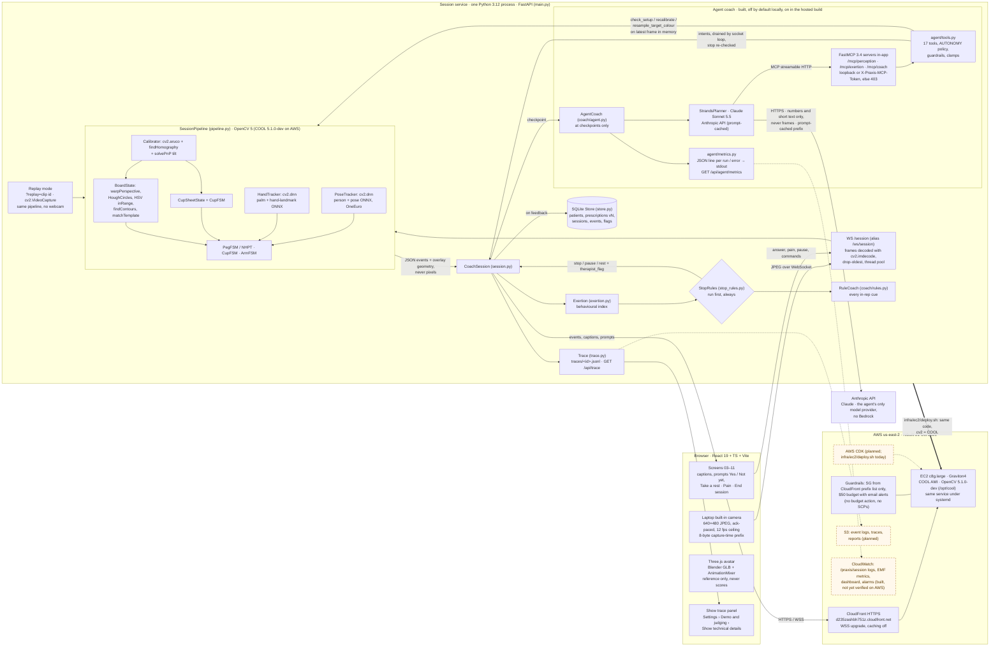
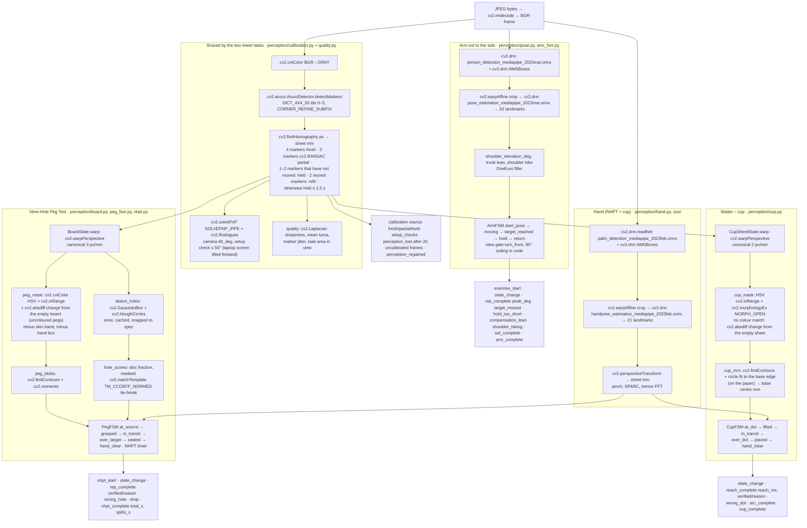
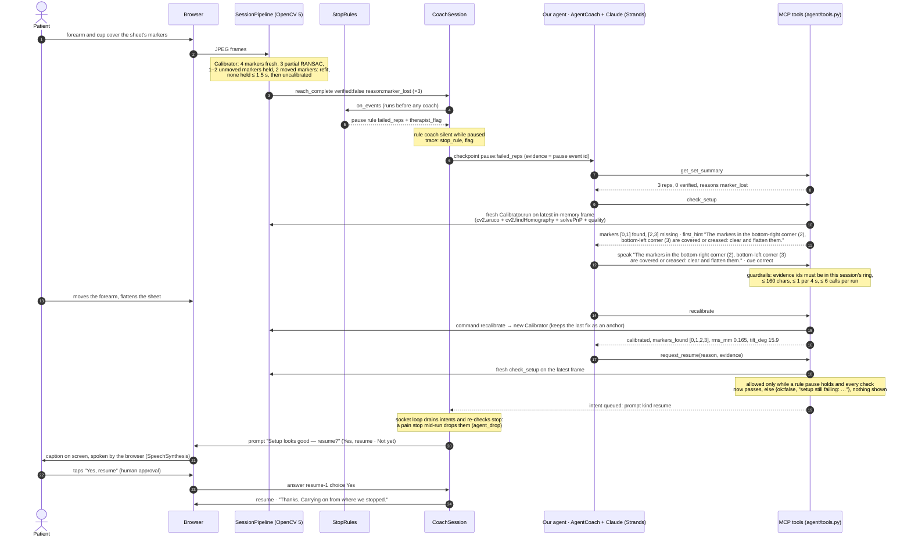
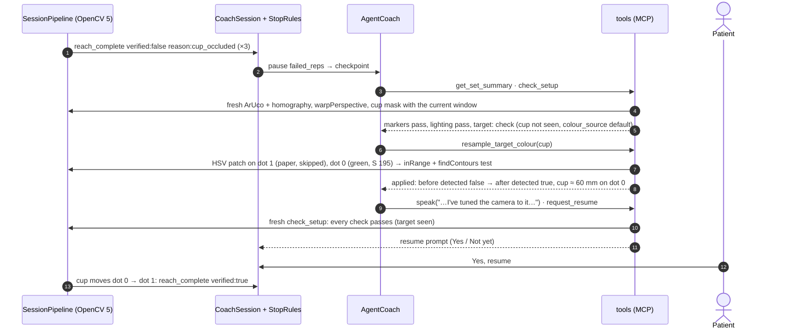

# Praxis: Architecture

This page has three diagrams for judges:

1. the whole system;
2. the OpenCV 5 pipeline for each exercise;
3. one real agent loop where the OpenCV output changes what the agent does next.

Every module and function named here exists in `services/session/praxis_session/` (checked again on 25 Oct 2026).

**How to read the diagrams.** Solid boxes and arrows are built and tested. **Dashed boxes and arrows are planned or not yet running on AWS.**

Since 11 Oct 2026 the session service runs on AWS. We rebuilt it on 21 Oct in a new account. It is a Graviton4 c8g.large launched from the COOL AMI (COOL's OpenCV 5.1.0-dev) behind CloudFront HTTPS. The COOL vs stock benchmark is in `benchmark/`. Still not built: S3, CDK and the tools Lambda (there is no `services/tools-lambda/` folder). CloudWatch logs, metrics, dashboard and alarms are built but not yet verified on AWS (`infra/ec2/README.md`). Our agent uses Claude via the Anthropic API; Bedrock is not used.

## 1. System architecture

**What runs where today.** In edge mode, everything above the AWS box runs on one laptop (`uv run uvicorn praxis_session.main:app`). The same service also runs on the c8g instance for the hosted judge endpoint (the AWS box), and in one container (`services/session/Dockerfile`) hosted on Railway for team review. On the laptop, no frame leaves the machine. On Railway, frames travel over TLS to the container, where they are processed in memory and dropped (`docs/RISKS.md`, 17 Sep row). `PRAXIS_CLOUD_ENABLED` defaults to `0` and gates every cloud call. The agent's model is Claude via the Anthropic API, called from wherever the service runs (the laptop or the c8g instance). `PRAXIS_AGENT=bedrock` falls back to the rule coach alone (12 Oct).

**Agent status.** Our agent is built (29 Sep). It is off by default locally (`PRAXIS_AGENT=off`) and on in the hosted build (`deploy.sh --agent`). We tested it offline with `ScriptedPlanner` (in CI) and since 10 Oct against real Claude through the Anthropic API (Sonnet 5.5 since 12 Oct). The real-model run below includes (`docs/AGENT.md`):

- MCP access control, quoted patient text, the camera-checked resume, the praise limit, metrics, the session plan, the autonomy table and `resample_target_colour` (10 Oct);
- the 11 Oct audit fixes: closing the socket cancels the agent run, feedback replaces stale checkpoints, and ended sessions are read-only for the agent.

> **Real model:** the default is Claude Sonnet 5.5 via the Anthropic API. We picked it over Sonnet 5 and Haiku 5.5 after measuring them side by side (`docs/AGENT.md` § Model choice).
> - **On real video** (REHAB24-6 through this pipeline, `evaluation/results/agent_video_v0.md`): 40 sessions. It named a fault that motion capture confirmed, and gave a correction, in 41 of 44 set reviews (patient taps simulated). It named the specific fix on 26/26 real wrong-view pauses, and offered no resume while the view stayed wrong. 0 guardrail violations, $0.050 per session.
> - Synthetic, 15 scenarios, latest run (21 Oct): 15/15, 0 guardrail violations, first action p50/p95 3.7/6.2 s, $0.020 per session. A harder 16th scenario (`mixed_signals`) fails 0/3 and stays open.
> - Agent vs rule-only: `evaluation/results/agent_ablation_v0.md`.

## 2. OpenCV 5 pipeline per exercise

`SessionPipeline.process(frame_bgr, t, frame_index)` uses the mode the socket was opened with. Each mode returns one `frame` event per frame plus the state-machine events below. The `frame` event holds overlay geometry in frame pixel coordinates, never the pixels themselves. Module docstrings note `cv2.__version__` (5.0.0, `opencv-python-headless==5.0.0.93`).

Some notes so the diagram is not read as more than it is:

- A rep the camera could not check is **unverified, not failed**. Examples: `reach_complete` with `cup_occluded` or `marker_lost`, and NHPT `rep_complete` with `no_hand_near_hole`. Performance misses (`target_missed`, `hold_too_short`) are counted separately.
- Arm angles are progress numbers measured in the image, relative to the camera. They are **never goniometry** (clinical joint-angle measurement). From the front view, abduction cannot be told apart from a lift in the scaption plane.
- The sheet-task thresholds (HSV windows, Hough, hand gates) were tuned on renders and fixed after our live team sessions; they have no labelled real-camera accuracy yet. The arm's hike allowance and front-view gate were set from REHAB24-6 real video (`evaluation/results/rehab24_thresholds_v0.md`).
- The hidden exercises (Pendulum, Arm to the front, Rotate out, Rotate in) still have code in `ArmFSM` and the registry. But `visible: False` keeps them off every screen, and the socket refuses them (`not_offered`).

## 3. Agent workflow: one perception → decision → action loop

This diagram follows the committed scenario `evaluation/agent/scenarios/covered_marker.json` (trace `traces/agent/covered_marker.jsonl`, scripted planner). The scenario hides ArUco markers 2 and 3 (the two bottom corners, where a resting forearm would lie) in the frame the tools see, and sends three `reach_complete` events marked unverified (`marker_lost`). In a live session, `marker_lost` means the sheet could not be tracked: no marker in view (or the visible ones moved) for more than 1.5 s. One covered marker leaves a three-marker RANSAC fit. Since 24 Oct, two covered markers also hold the fix as long as the other two have not moved (and two that have moved refit it), so live this case is rarer than in the scenario; the scenario still tests the tool path.

Here is what happens. The stop rules pause the session before the agent sees anything. The agent then runs OpenCV on the latest frame, tells the patient the specific fix, recalibrates, and asks whether to resume. Only the patient's "Yes" resumes the session.

Who controls what in this loop:

| Layer | What it does here | Code |
|---|---|---|
| Stop rules | Pause and flag the therapist after three unverified reps (a peg the board saw seated does not count). Also: pain ≥ 7 in session stops; three missed reps in a row and 60 s of high exertion give a rest; three trunk leans and lost tracking pause. Runs before any coach. | `stop_rules.py` `StopRules.on_events`, `on_exertion`, `on_checkin`, `on_pain` |
| Checkpoint | Only these start an agent run: `checkin`, `set_complete`, `arc_complete`, `nhpt_complete`, `pause:failed_reps`, `pause:perception`, `pause:setup`, `feedback`. | `session.py` `CHECKPOINT_EVENTS`, `CHECKPOINT_PAUSES` |
| Autonomy | One table marks each tool as `autonomous`, `forbidden_after_stop`, `patient_approval` or `never`. `invoke` enforces it, and every `agent_run` row records `policy_version`. | `agent/tools.py` `AUTONOMY`, `invoke` |
| Plan | `set_session_plan` runs at check-in. Changing the plan needs new evidence ids and a `because`. It shows up as `plan` trace rows and as `summary.coach.plan` in the report. | `agent/tools.py`, `session.py` `set_plan` |
| Evidence | Every coach tool must cite event ids that exist in this session's ring buffer, or the call is refused. | `agent/tools.py` `_action_guard` |
| Clamps | Dose changes (`propose_adjustment`) are clamped to the prescription by `prescription.clamp` and turned into a Yes / Keep / Why prompt. On Yes, `SessionPipeline.command` clamps them again. | `agent/tools.py`, `prescription.py`, `pipeline.py` |
| Budgets | ≤ 6 tool calls and ≤ 15 s per run (25 s for a pause run), ≤ 60 calls and ≤ 12 runs per session; rest 10–120 s. | `agent/tools.py` constants, `agent/model.py` `RUN_TIMEOUT_S`, `coach/agent.py` |
| Human approval | A resume or a dose change happens only when the patient taps to accept. A resume is offered only after a fresh `check_setup` passes. Saying no changes nothing. | `session.py` `on_answer`, `_answer_agent_prompt`; `agent/tools.py` `request_resume` |
| Security | MCP routes accept only loopback requests without proxy headers, or requests with the per-process `X-Praxis-MCP-Token`. Patient text reaches the model only as length-capped, quoted data. | `agent/mcp_server.py` `MCPAccessGuard`; `agent/model.py` `quote_patient_text` |
| Observability | One JSON log line at the end of each run and for each error. With `PRAXIS_EMF=1` it adds CloudWatch EMF metrics (runs, fallbacks, errors, cost estimate, first action). Also `/api/agent/metrics`. Session/ops lines and the CloudWatch agent, dashboard and alarms are in `infra/ec2/README.md` (built, not yet verified on AWS). | `agent/metrics.py`, `ops.py`, `main.py` |
| Privacy | No tool result, trace row or model message holds pixels (`assert_no_pixels` on every result). | `agent/tools.py` |
| Failure | On a model error, timeout or refusal: `agent_error`, `agent_status offline`, and the rule coach carries on. If MCP is down, the same functions are called directly as tools (`transport: direct`). | `coach/agent.py`, `agent/model.py` |

`pause:perception` (tracking lost for about 3 s) follows the same `check_setup → speak → recalibrate → request_resume` path. A perception pause also clears itself when `perception_regained` arrives, so the patient is never stuck behind a pop-up. `pause:setup` follows the same path too. It happens in Arm out to the side when the pose is seen but the view check fails: 3 s turned away from the camera (for example standing side-on), or 6 s with the practising shoulder or elbow out of view. Here the pose facts (`facing` vs `needed_view`, both shoulders, elbow, trunk lean) are used to name the fix (`arm_setup` scenario). Since 25 Oct the hips do not need to be in view for Arm out to the side.

### 3.1 Active perception: the camera result changes the next tool call (green cup)

Scenario `evaluation/agent/scenarios/green_cup.json` (trace `traces/agent/green_cup.jsonl`): the patient uses a green cup. The default HSV colour band looks for the blue base, so the cup is never seen. (Since 24 Oct a live session also finds a cup of any colour by its change from the empty sheet, so this case is now rarer; the scenario still tests the tool path.) With the hand model on, placements are worked out from the hand position and reported as unverified (`cup_occluded`). Three in a row pause the session.

With the agent off, the same scenario stays paused with a generic message, and no reach is ever verified (`evaluation/results/agent_ablation_v0.md`).

More detail: `docs/AGENT.md` (tools table, configuration, web contract) and `docs/ENGINEERING_NOTES.md` §2–§4.
