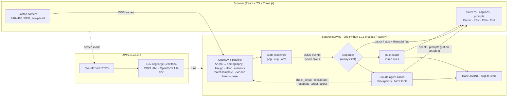

# Praxis: an agentic vision coach for upper-limb rehab at home

**Technical report · OpenCV AI Competition 2026 (powered by AWS) · Team Praxis · 11 Oct 2026**

Live (AWS Graviton4 + COOL, HTTPS): **https://dl8xykmg8ki61.cloudfront.net** · Judge quick-start: [`docs/JUDGE_QUICKSTART.md`](JUDGE_QUICKSTART.md) · Diagrams: [`docs/ARCHITECTURE.md`](ARCHITECTURE.md) · Full engineering detail, module by module: [`docs/ENGINEERING_NOTES.md`](ENGINEERING_NOTES.md)

> Praxis is an adherence and coaching aid for exercises a therapist has already prescribed. **It is not a medical device.** It does not diagnose and does not choose exercises, and its angles and times are not clinical measurements.

## Summary

After a stroke or a shoulder injury, most of the work of recovery happens at home, between clinic visits, with nobody watching. Patients get a printed sheet of exercises. They do not know whether a repetition counted, they compensate without noticing, and the therapist sees nothing until the next visit.

Praxis uses **one ordinary laptop camera, a printed A4 sheet and a cup or a few pegs** to coach three therapist-prescribed exercises: **Arm out to the side** (shoulder abduction), **Waiter – cup** (a GRASP coordination task) and the **Nine-Hole Peg Test** (a standardized weekly assessment).

- **OpenCV 5 does the measuring.** ArUco markers on the printed sheet give a metric homography. Pegs, holes and the cup are found with Hough circles, HSV segmentation, contours and masked template matching. Hand and body landmarks come from OpenCV Zoo ONNX models run through `cv2.dnn`. Each exercise has a state machine that turns this into timestamped events: a rep, a reach, a peg seated, a trunk lean, tracking lost.
- **Stop rules in code run before any coach** (pain ≥ 7, new symptoms, repeated trunk lean, repeated reps the camera could not check, sustained exertion, tracking lost). They pause or stop the session and flag the therapist.
- **Two coaches share one interface.** A deterministic rule coach gives every in-rep cue. A **Claude agent coach** runs at checkpoints and calls OpenCV itself through MCP tools: `check_setup` runs a fresh ArUco/homography/pose check on the latest frame, and `resample_target_colour` re-segments a cup it cannot see. The camera result decides the agent's next step: name the covered corner, re-sample the colour, offer to resume only after the camera check passes. Every dose change and every resume is a prompt the patient answers.
- **It runs on AWS.** An EC2 **c8g.large (Graviton4)** launched from the **COOL AMI** runs the same service on COOL's OpenCV 5.1.0-dev behind CloudFront HTTPS. We measured COOL against the stock OpenCV wheel on the same instance.

What is measured and what is not, in one place:

| Area | Status (11 Oct 2026) |
|---|---|
| OpenCV 5 pipeline, three exercises, every screen, stop rules, rule coach, trace, replay | built; 636 service tests + 945 web tests green; CI on every push |
| Claude agent coach (17 tools over MCP, autonomy table, guardrails) | built; **real Claude**, 15 scenarios × 3: 44/45 passed, **0 guardrail violations** (§8.3) |
| AWS: Graviton4 + COOL + CloudFront | **live** (stopped between work sessions); 634/636 tests pass on COOL; benchmark re-measured 11 Oct (§7) |
| Accuracy on real people | **Arm out to the side only, on a public lab dataset** (REHAB24-6, 8 healthy adults, front camera, 88 reps): angle MAE **3.8°** vs motion capture (95 % limits −9° to +10°), rep-peak MAE 4.1°, rep F1 **0.94** (§8.4). Two pose defects it exposed are fixed. NHPT and Waiter – cup: synthetic only (§8.1); our own-recordings protocol is built, not run (§8.6). |
| Usability (SUS), patient or therapist pilots | not run (§8.7) |
| Bedrock, S3, CloudWatch shipping, CDK | not built (§7.4) |

---

## 1. Problem

**Stroke is common, disabling and growing.** Stroke is the second-leading cause of death worldwide and the third-leading cause of death and disability combined. Between 1990 and 2019, new strokes rose 70 % and the number of people living after stroke rose 102 % [1]. More than 70 % of people who have a stroke have upper-limb deficits [2]. In a cohort of 102 patients with arm paresis after an acute stroke, only 11.6 % had complete functional recovery of the arm at six months [3]. Shoulder problems add to this: in one ultrasound screening of a whole village, 22.1 % of residents had a full-thickness rotator-cuff tear, rising to 36.6 % in their 80s [4].

**Recovery needs repetitions that clinic time does not provide.** Across 312 observed therapy sessions, task-specific upper-limb practice happened in only 51 % of sessions and averaged **32 repetitions** when it did [5]. The rest is meant to happen at home. But non-adherence to self-managed home physical therapy can reach **70 %** [6]. Access is the other constraint: about **2.4 billion** people live with a condition that could benefit from rehabilitation [7, 8]. In some low- and middle-income countries more than half of them do not receive the services they need, and many settings have fewer than 10 skilled practitioners per million people [7].

**Home programs work when people do them.** GRASP (Graded Repetitive Arm Supplementary Program, UBC) is a self-administered arm program. In a randomized trial of 103 stroke inpatients, it improved arm function on the CAHAI by 6.2 points over an education control (95 % CI 3.4–9.0), and the gain held at five months [2]. The **Nine-Hole Peg Test** is a standard, quick measure of finger dexterity with adult norms [9, 10]. In stroke its smallest real difference for the more-affected hand is large: 32.8 s [11]. That is one reason a weekly, consistently administered test with per-peg splits is more useful than an occasional clinic reading.

**What goes wrong at home is specific.** (1) *No feedback on quality*: the patient cannot tell whether the lift reached the target, whether it was held, or whether the trunk leaned to fake the range. (2) *No dose control*: on a bad day patients either push through pain or skip the session, and both are invisible. (3) *No signal to the therapist*: the clinician learns about a missed week, a pain spike or a compensation pattern at the next visit, weeks later. (4) *Outcome measures need the clinic*: the Nine-Hole Peg Test is quick, but it is timed by a clinician with a stopwatch.

**Why a camera, and why now.** Every patient with a laptop already owns the sensor. OpenCV 5 can turn a printed sheet into a calibrated measuring surface with four ArUco markers, run hand and pose networks on a laptop CPU in milliseconds, and do all of it in memory without storing video. What has been missing is a system that is honest about what one webcam can measure, keeps the therapist in charge, and stops itself when it should.

## 2. Users and design principles

| | **Patient (primary)** | **Therapist (secondary)** |
|---|---|---|
| Who | Adult after stroke or a shoulder injury, practising at home between visits; often older, often one-handed, may have low vision or reduced dexterity; not technical | Occupational or physiotherapist with a caseload of home programs |
| Needs | Know what to do and whether it counted; a safe dose on bad days; an easy way to stop; no surveillance feeling | Adherence they can trust; pain and safety events early; an objective trend (NHPT time, reach time, range); control of the prescription |
| In Praxis | Check-in → demonstration → camera setup → live session with captions → 3-question feedback → report | Read-only dashboard: adherence from real sessions only, flags with reasons, NHPT trend, and the prescription editor (practice days, versioned) |

**Principles we held to** (from the hi-fi wireframes, `docs/wireframes/`):

1. **The therapist prescribes; the coach proposes inside the prescription; code enforces it.** Dose, allowed adaptations and stop rules are a versioned prescription. Every proposed change is clamped to it.
2. **Unverified is not failed.** A rep the camera could not see (the hand covers the cup, a marker drops out) is counted as *unverified*, shown next to the verified count everywhere, and never held against the patient.
3. **Feeling is self-reported.** Pain and effort come from what the patient taps or says. The face is never analysed for pain or emotion, and person detection is used for presence and pose only.
4. **No composite score.** No "accuracy" or "recovery" number appears anywhere. The app shows reps (verified / unverified), times and camera-relative angles, each labelled as such.
5. **The patient can always stop.** Pause · Take a rest · Pain / feel unwell · End session are fixed on every live screen. A resume is always the patient's tap.
6. **Say what is simulated.** The rule coach says it is rule-based, a replay says "Replay", sample data says "Sample", and every trace row names its source.

## 3. What exists and what is new

Camera and sensor rehab products exist. Their makers describe them as follows (vendor claims, not independently checked):

| Product | Approach | How Praxis differs |
|---|---|---|
| Kemtai | software-only motion tracking on a phone, tablet or laptop camera, general exercise and musculoskeletal programs | Praxis adds a **metric printed surface** (ArUco homography) for hand and object tasks, a standardized dexterity test, and therapist stop rules in code |
| Neofect Smart Glove | wearable sensor glove with games for stroke hand and arm rehab | Praxis needs **no wearable**: one laptop camera, a printed sheet, a cup and pegs |
| MIRA | exergame platform for upper-limb rehab (feasibility study with 10 outpatients) | Praxis coaches the prescribed exercise itself (GRASP task, abduction) and **verifies each rep** from vision events, rather than scoring a game |

In our search we found no webcam product that times the Nine-Hole Peg Test at home and coaches therapist-prescribed upper-limb exercises with an agent. That is a negative search result, not proof that none exists.

**What is new in Praxis:**
- **A printed sheet as a metric instrument.** Four ArUco markers turn an A4 page into a calibrated plane (px ↔ mm, reprojection error reported). That plane is what lets a laptop camera time a Nine-Hole Peg Test peg by peg and measure cup reaches dot to dot without any wearable.
- **An agent whose tools are OpenCV.** The agent does not only read events. It can re-run calibration on the current frame, re-sample the target's colour, and re-check the camera before offering to resume. The vision result decides the next tool call (§6.3).
- **Safety outside the model.** Stop rules, clamps and the autonomy table are code the model cannot talk its way past, and the tests prove it (0 guardrail violations over 45 real-model runs, including a prompt-injection scenario).
- **Honest perception.** Verified / unverified / missed are separate outcomes with reasons. Tracking loss pauses the session with the reason on screen, and resumes on its own when tracking returns.

## 4. System architecture



**One process, events not frames.** The browser sends 640 × 480 JPEGs over a WebSocket, each prefixed with its capture time. It sends the next frame only after the service has answered the previous one, so a slow host gets fewer, fresher frames instead of a growing queue. The service decodes each frame with `cv2.imdecode`, runs the pipeline in a thread pool (OpenCV releases the GIL), and returns JSON: events, overlay geometry in frame pixels, captions and prompts. Frames are dropped after processing. **No frame, pixel or image is written to disk, put in an event or a trace row, or sent to the model**, and a test checks every agent tool result for pixels.

**Two deployment modes, same code.** *Edge mode* runs the service on the patient's laptop (`uvicorn`), where no frame leaves the machine; this is the privacy story. *Hosted mode* runs the identical service on the c8g instance behind CloudFront (§7); frames travel over TLS and are processed in memory and dropped. The camera-setup screen names where processing happens. **Replay mode** pushes a recorded clip through the identical pipeline and coach with no webcam. It is the judges' fallback and is badged "Replay" everywhere.

**Stack.** Python 3.12, FastAPI, `opencv-python-headless==5.0.0.93` (pinned; COOL's build on AWS), NumPy, Strands Agents SDK + FastMCP 3.4 (MCP streamable HTTP, spec 2025-06-18), SQLite; React 19 + TypeScript + Vite, Radix, Tailwind 4, Three.js (a Blender-built GLB avatar, generated in code). Every dependency is pinned (`uv.lock`, `pnpm-lock.yaml`) and the ONNX models are SHA-256 pinned.

## 5. OpenCV 5 implementation

Every perception module names `cv2.__version__` in its docstring. Each stage below is substantive OpenCV work, and each is tested on synthetic frames rendered by our own projector (`perception/synth.py`: pinhole camera, tilt, yaw, noise).

| Stage | OpenCV 5 | Output |
|---|---|---|
| Sheet calibration | `cv2.aruco.ArucoDetector` (DICT_4X4_50, sub-pixel corners) → `cv2.findHomography` on 16 corners; `cv2.RANSAC` 3-marker fallback (threshold in px); `cv2.flip` re-detection for mirrored video; `cv2.solvePnP` (IPPE) + `cv2.Rodrigues` for camera tilt | px ↔ mm homography, reprojection RMS (≈ 0.2–0.4 mm on renders), source `fresh / partial / held`, `mirrored` |
| Setup quality | luma mean, `cv2.Laplacian` variance (blur), marker-corner jitter over 10 frames, task-area projection, px/mm; each missing marker predicted from the visible ones (`cv2.findHomography`) and tested against the frame and ArUco's undecoded candidates | checklist rows with a specific fix each: a corner "outside the picture", "covered", or "in view but cannot be read" |
| NHPT board | `cv2.warpPerspective` to a 3 px/mm top view; paper-referenced normalisation (grey `morphologyEx` close → `cv2.divide`: flat field + white balance, ≈ 0.5 ms board / 1.3 ms cup sheet); `cv2.HoughCircles` once (cached, snapped to spec); `cv2.inRange` (HSV, skin band excluded for every tone) + `cv2.findContours` + `cv2.minAreaRect` length gate; masked `cv2.matchTemplate` (`TM_CCOEFF_NORMED`) as tie-breaker | `hole_k: empty / occupied`, free pegs in mm |
| Cup on target sheet | warp to 2 px/mm; the same paper normalisation; HSV `inRange` + `morphologyEx` open; contours grouped around the largest (fingers split the base) and gated on size and `minAreaRect` aspect; `cv2.moments` | cup-base centroid in mm, over-dot test |
| Hand | OpenCV Zoo palm detector + hand-landmark ONNX via `cv2.dnn` (Apache-2.0) | 21 landmarks → mm via the homography; pinch aperture, path speed, SPARC smoothness, tremor (FFT, 3–12 Hz) |
| Pose | OpenCV Zoo person detector + BlazePose ONNX via `cv2.dnn` | shoulder angle (One-Euro filtered), trunk lean, shoulder hike, view and visibility gates |
| Tap-to-sample colour | 6 mm HSV patch → ±12° hue window | works with wooden pegs or any cup colour |

**Calibration that survives a real table.** The first fix needs all four markers. After that, a forearm over a corner is normal, so three markers give a RANSAC homography and fewer than three hold the last fix for 1.5 s. Only then is the frame uncalibrated, and 20 such frames raise `perception_lost`, which pauses the session with the reason on screen; `perception_regained` resumes it. Because the sheet homography ignores height, `solvePnP` estimates the camera's tilt from the marker corners. For a laptop camera tilted forward over a sheet 25–35 cm away, setup advises below 50°. The 50° cap comes from geometry (a 20 mm peg top must not project onto the next hole at 32 mm pitch) and is unverified on real pegs.

**Robust to the room, not just the render (11 Oct, synthetic sweep).** `evaluation/scripts/robustness.py` renders both sheets under 107 perturbations, one at a time and combined, and runs the real calibration, setup rows, occupancy and cup code (`evaluation/results/robustness_v0.md`). Its first run found real fragilities, each fixed test-first: a dim room lost every peg and the cup (fixed by normalising each canonical view to the paper's own brightness, a grey-level closing that acts as flat field and white balance in one step); a warm bulb turned the paper into 6–7 phantom pegs (same fix); a deep skin tone read as four pegs (the skin band now reaches V 40); a pen read as a peg and as a cup 85 mm away (length and aspect gates); fingers splitting the cup base hid a cup that was 55 % visible (fragments are grouped); mirrored video never calibrated (ArUco re-runs on the flipped frame and maps the corners back); and the A4 PDF printed on US Letter lost two markers (the page is now cut to what both papers share, with geometry unchanged). After the fixes, on renders: the sheet calibrates from 0° to 65° tilt, at any in-plane rotation, from 30 % to 100 % frame fill, at mean luma 30, under warm/cool casts, shadows, noise σ 20, JPEG q40, 5 px motion blur and defocus r3; the worst target error is 1.2 mm (a sheet filling 30 % of the frame) except for a curled or creased sheet (1.2–11 mm) or a barrel lens (1–2.4 mm, the homography assumes none); and every setup row in the sweep names the right cause. A review of the code also fixed two timing biases (§8.1) and a units bug: the three-marker RANSAC threshold was 3 mm, not the documented 3 px.

**Three state machines turn geometry into events.**
- *Nine-Hole Peg Test*: `at_source → grasped → in_transit → over_target → seated → hand_clear`. Grasp fires when a free peg disappears, or when the pinch aperture is ≤ 25 mm in the source zone (pegs lifted from a dish). Occupancy is debounced over 0.25 s. A hole that fills with no hand within 30 mm in the last 0.5 s is counted but marked `unverified (no_hand_near_hole)`. The timer runs from the first lift to the ninth seat, with per-peg splits; events are `rep_complete`, `wrong_hole` and `drop`.
- *Waiter – cup*: `at_dot → lifted → in_transit → over_dot → placed → hand_clear` along the arc 1→5→1, with reach time per dot, `wrong_dot`, two slow arcs, then two fast arcs **only after the patient answers Yes** to the progression prompt. A placement seen only through the hand is `unverified (cup_occluded)`, unless the base was seen resting on the target dot within 0.6 s before hand-clear.
- *Arm out to the side*: `start_pose → moving → target_reached → hold → return`. The target is clamped to the 90° ceiling in code. A verified rep reaches target − 10° and holds 3 s; misses (`target_missed`, `hold_too_short`) are counted separately from unverified reps. The machine freezes (`arm.gate`) when the patient faces the wrong way or the joints are not visible, so it never scores what it cannot see. `compensation_lean` needs |lean| > 12° held 0.5 s with both hips visible; `shoulder_hiking` needs both shoulders visible.

**Exertion is behavioural and labelled so.** Rep-time slope, falling peak angles, tremor share and the last self-reported effort (fading after 120 s of steady work) give `low / moderate / high` with plain-language reasons. The chip in the session and on the report says *behavioural*. Sixty seconds at high is a stop rule. We do not estimate heart rate from the face.

**The avatar is a reference, never a judge.** A gender-neutral mannequin, built in code by headless Blender (no third-party meshes) and played with Three.js `AnimationMixer`, demonstrates each exercise and shows the tempo (lift 3 s, hold, lower) on the live screen. Recorded human motion (UI-PRMD, IntelliRehabDS) shapes two clips, scaled so the arm never goes above the prescribed 90°. Reps are verified from OpenCV events only.

## 6. Coaching: stop rules first, then two coaches

### 6.1 Order of operations per frame
perception events → behavioural exertion → **stop rules** → coach → trace. The stop rules (`stop_rules.py`, thresholds from the prescription: pain ≥ 7, new or worse symptoms at check-in, trunk lean > 12° three times, three reps in a row the camera could not verify, three performance misses in a row (gentle rest), exertion high for 60 s, tracking lost) run before either coach sees the event. Each writes a therapist flag where a clinician should see it. While a session is stopped or paused, both coaches are silent.

### 6.2 Rule coach (every in-rep cue)
The rule coach is deterministic, rate-limited, and labelled "Rule-based coach" on screen and in every trace line. Its actions are `instruct | correct | progress | regress | rest | stop`, and each `Decision` must cite the event ids it came from. Its event→cue time is about 1 ms (§8.2), which is why in-rep cues stay with it.

### 6.3 Claude agent coach (checkpoints)
At checkpoints (check-in, end of a set or arc, a stop-rule pause, NHPT complete, session end) `AgentCoach` runs one background task with Claude (Sonnet 5; Anthropic API today, Bedrock by configuration). The task is bounded: ≤ 6 tool calls, 15 s, 12 runs per session and a daily cap. The model reaches **17 tools on three FastMCP servers** (`perception`, `exertion`, `coach`) over streamable HTTP. If MCP is down, the same functions are bound directly and the trace says `transport: direct`.

**OpenCV tools, not just event readers.** `check_setup` runs a fresh `cv2.aruco` detection, `cv2.findHomography` (reprojection error in mm), `cv2.solvePnP` tilt, lighting, sharpness, marker steadiness and target visibility on the latest frame, held in memory by reference. `recalibrate` resets the calibrator or pose gate and reports the next frames. `resample_target_colour` warps the sheet, samples HSV where the target should be, and applies the new window **only if `inRange` + `findContours` then find the target where they failed before**.

**OpenCV output changes the next action.** From the real-Claude trace `traces/agent/anthropic/covered_marker.jsonl`:

```
stop rule    failed_reps: "Three in a row I couldn't verify. Let's pause and check the setup."
agent tool   get_set_summary
agent tool   check_setup → markers: "Markers missing: bottom-right corner (2) …"          (4 ms, MCP)
agent tool   speak "The bottom-right corner of your sheet is covered or out of view —
                    flatten the sheet so all four corners show."
agent tool   recalibrate → markers_found [0,1,2,3], rms_mm 0.165, tilt_deg 15.9      (132 ms)
agent tool   request_resume → fresh check_setup passed → prompt "… Ready to carry on?"
patient      Yes → resume: "Thanks. Carrying on from where we stopped."
```

In `green_cup`, the default blue window cannot see a green cup, so the agent calls `check_setup` and gets "target not seen". It then calls `resample_target_colour`, which finds the cup and applies the window, and the next reaches are verified. The rule coach alone cannot do this (§8.3).

**Autonomy is a table in code, not a sentence in a prompt.** Every tool is classed as `autonomous` (read-only checks, speak), `patient_approval` (dose changes and resume become Yes / Keep / Why prompts, applied only on Yes and clamped twice, by the prescription and again by the pipeline), `forbidden_after_stop`, or `never`; once the session has ended (feedback sent) only reads and the report note run. Evidence ids must be whole numbers that exist in the session's own event ring, and every dose number must be finite (a NaN used to clamp to the prescription's maximum until the 11 Oct audit). Agent outputs are intents drained by the socket loop, which re-checks the stop rules, so a pain stop that lands mid-run drops them (`agent_drop`). When the patient's socket closes, the run in flight is cancelled (traced `outcome: cancelled`) and nothing pending runs; the feedback checkpoint supersedes stale ones and still runs after a stop, so the report note can explain it. `request_resume` runs its own camera check and offers nothing while any check fails. The patient's free-text check-in note reaches the model only as a capped, markup-stripped data field, and the check-in event the model can read carries typed values only. A prompt-injection scenario tests that it cannot move the target. MCP routes answer only loopback clients without any proxy header, or a per-process token (403 from the internet on AWS, tested through uvicorn's proxy-header middleware with a forged `X-Forwarded-For: 127.0.0.1`).

**Observable.** Every run writes `agent_run` (trigger, model, transport, tokens, ms, first-action ms, outcome), `tool` rows (args, result summary, ms, and an `opencv` digest for the OpenCV tools: failing checks, hint, markers, homography error, target seen), agent `decide` rows naming their run and tool, `agent_error`, `agent_drop` and `coach_note` to the session trace. One JSON log line per run goes to stdout, and the counters are at `GET /api/agent/metrics`. On screen, the agent's status shows *thinking / idle / offline*. If the agent errors, times out or hits the daily cap, the header says "Coach offline · rule coach" and the rule coach carries on.

## 7. AWS deployment and COOL

### 7.1 What runs
| | |
|---|---|
| Compute | EC2 `<instance-id>`, **c8g.large (Graviton4, Neoverse-V2, 2 vCPU, 4 GiB)**, us-east-2, 60 GB gp3, Elastic IP |
| Image | AWS Marketplace **COOL AMI** `ami-005a9f90c70ba8d9b` (Cloud Optimized OpenCV for Graviton v3, Ubuntu 24.04); `cv2` 5.1.0-dev from `/opt/cool`, SVE + NEON baseline, KleidiCV 0.7.0 HAL |
| Service | the same FastAPI service under systemd; venv from `uv.lock` **minus** the OpenCV wheel, so `import cv2` resolves to COOL; the install refuses to continue unless `cv2.__file__` is under `/opt/cool` |
| HTTPS | CloudFront `<cloudfront-id>` → `dl8xykmg8ki61.cloudfront.net` (HTTP→HTTPS, caching off, all viewer headers forwarded so WebSockets upgrade) |
| Network | security group: port 8000 only from the CloudFront origin prefix list and one admin IP; SSH from that IP only; MCP routes 403 from the internet |
| Cost and safety rails | Organizations SCPs (small Graviton types, two regions only); $50/month budget whose action **stops the instance** at 100 %; anomaly alerts; root MFA; no long-lived keys (CloudShell); ≈ $0.10/h running, stopped between work sessions |
| Deploy | one idempotent command: `infra/ec2/deploy.sh <host> [--agent]` |

**Verified on the instance.** `/health` through HTTPS reports `opencv_build {version 5.1.0-dev, cool: true, dnn: true, arch: aarch64}`, with the hand and pose models loaded and the agent ready. The full service test suite run against COOL's `cv2` passes **634 / 636**; the two failures check `.gitignore` rules and need a git checkout that the host does not have. A full Waiter – cup replay over `wss://` through CloudFront produced 517 frames, 31 reaches, 33 coach decisions and agent runs.

### 7.2 COOL vs stock OpenCV on the same Graviton4
`benchmark/cool_bench.py` times Praxis's own per-frame stages on identical JPEG bytes from the two replay clips (640 × 480, q80). It runs them under COOL's `cv2` and under the pinned stock wheel (`opencv-python-headless==5.0.0.93`, NEON, KleidiCV 26.03), interleaved over 3 rounds × 5 passes on one c8g.large. `benchmark/summarize.py` writes the table from the raw JSON (`benchmark/results/cool_vs_stock_c8g.md`, `raw_v1/`). This run (v1) measures the code after the 11 Oct perception audit, whose brightness normalisation adds about 0.7 ms to the warp and about 2 ms to the cup stage; the first run (v0) is kept in `raw_v0/`.

| p50 ms per frame | Stock 5.0.0 | COOL 5.1.0-dev | Speed-up |
|---|---|---|---|
| Peg mask (HSV `inRange`) | 0.481 | 0.304 | **1.58×** |
| Peg blobs (`findContours` + moments) | 0.576 | 0.395 | **1.46×** |
| Holes (`HoughCircles`) | 2.181 | 1.526 | **1.43×** |
| Occupancy (masked `matchTemplate` × 9) | 3.359 | 2.878 | **1.17×** |
| Cup (warp + normalise + `inRange` + contours) | 3.369 | 3.317 | 1.02× |
| `warpPerspective` + normalise | 1.185 | 1.319 | 0.90× |
| JPEG decode | 0.566 | 0.620 | 0.91× |
| ArUco + homography + solvePnP | 1.893 | 2.192 | 0.86× |
| **Full NHPT frame** (classical) | 7.690 | 7.452 | **1.03×** |
| **Full cup frame** (classical) | 5.216 | 5.573 | 0.94× |
| Hand model (`cv2.dnn`) | 21.61 | 24.53 | 0.88× |

Compute cost per 1,000 frames (hourly price over frames per hour at the measured p50, one stream at a time): full NHPT frame **$0.00017 stock vs $0.00019 COOL**, full cup frame $0.00012 vs $0.00014. COOL's AMI adds $0.01/h.

**Reading it honestly.** COOL is 1.2–1.6× faster on the stages that dominate the NHPT board: thresholding, contours, Hough and template matching. It is slower on decode, ArUco, the warp and the DNN, because the stock aarch64 wheel already ships a newer KleidiCV, which makes it a strong baseline rather than a naive one. End to end, the classical NHPT frame is 3 % faster and the cup frame 6 % slower, and per frame COOL costs slightly more once its AMI fee is counted. Both builds process a classical frame in under 8 ms, far inside the 66–100 ms budget at 10–15 fps. We run COOL in production because it executes the whole workload on Graviton and speeds up the NHPT's heaviest classical stages, not because it is cheaper. Not measured yet: an x86 (c7i) reference, multi-session throughput, and browser-to-cue latency through CloudFront.

### 7.3 Why this shape
A single container keeps raw frames inside one process: there is no queue, no object store and no second service that could leak video. Graviton matches the classical OpenCV workload (SIMD-heavy, no GPU needed), and COOL is OpenCV built for it. CloudFront supplies the HTTPS a browser needs before it will open the camera, with no certificate management on the instance.

### 7.4 Not on AWS yet
The agent calls Claude through the Anthropic API. The Bedrock path (`PRAXIS_AGENT=bedrock`, Strands `BedrockModel`) is built and unit-tested but has not been run. Logs go to stdout as JSON (ready for CloudWatch) but are not shipped. The store is SQLite with the schema DynamoDB would mirror. There is no CDK app; the deploy is a script.

## 8. Evaluation

Every number below is regenerated by a script in `evaluation/` or `benchmark/`, and the results files record the host and settings. Real and synthetic data are never pooled.

### 8.1 Pipeline validation on synthetic renders (`evaluation/results/dataset_v0.md`)
These clips are OpenCV-rendered sheets with perspective, noise and scrambled order, plus a synthetic 33-point landmark stream for the arm, scored at the **product defaults** the app ships (debounce 2, clear 3).

| Exercise | Labelled reps | Rep F1 (P / R) | Timing / angle error |
|---|---|---|---|
| Nine-Hole Peg Test | 9 | 1.00 (1.00 / 1.00) | NHPT total-time error 0.0 s (0.2 s before 11 Oct) |
| Waiter – cup | 32 | 0.984 (1.00 / 0.969) | reach-time MAE 0 ms (200 ms before 11 Oct) |
| Arm out to the side | 16 | 1.00 (1.00 / 1.00) | peak-angle MAE 0.77° (landmark stream, not the detector) |

**These numbers validate the pipeline and state machines, not real-world accuracy.** No real lighting, hands, shadows or pegs are involved. An earlier scorer used looser settings than the app ships and reported 1.0 / 0 ms; we withdrew those numbers. The timing errors dropped to zero on 11 Oct for a different reason, a bug fix at the same product defaults: the debounce and the stationary check decide *whether* a peg is seated or a cup placed, but the event used to be stamped on the confirming frame, so every NHPT total was late by (debounce − 1) frames and every reach by (clear − 1) frames, a bias that changed with the frame rate. Events are now stamped at the first frame of the confirmed run (`t_seated`, `t_placed`, `t_grasp`; `tests/test_timing_bias.py`). On these renders the labels are frame-aligned, so zero is expected by construction; real error will come from real motion. The one cup miss is the clip ending before the last hand-clear.

**Robustness sweep** (`evaluation/results/robustness_v0.md`, renders only). 107 conditions over both sheets (tilt, lens focal length and barrel distortion, in-plane rotation, distance, light, colour cast, shadows, noise, blur, JPEG, marker and grid occlusion by four skin tones, peg and cup colours, clutter, US Letter printing, paper curl, mirroring, a squashed 16:9 frame, five combined scenes). After the fixes in §5: first fix on 74 / 81 NHPT and 83 / 91 cup conditions (the misses are heavy blur, markers under a hand or out of the frame, and the old Letter print); all holes correct on 69 / 74 calibrated NHPT conditions; the cup found within 10 mm on 67 / 77 (misses: colours outside the default window before tap-to-sample, a black band, a hand hiding ~80 % of the base); two phantoms, both on a sheet curled 20 mm; the setup rows give the right advice in every condition. Median target error 0.23 mm. Not covered and still open: real exposure and glare, 3-D pegs and cups, black pegs, and a curled sheet, which nothing flags (`docs/RISKS.md`).

### 8.2 Latency (`evaluation/results/latency_v0.md`)
These runs drive the real WebSocket handler in-process the way the browser does (JPEG q80, capture-time prefix, ack-paced) on an Apple-silicon laptop with the hand model on. Pooled p50 / p95: **capture → event 9.7 / 14.8 ms**, **event → cue 0.8 / 1.2 ms** (rule coach). The JPEG encode in the browser, the network hop and rendering are **not** included; the live screens show a browser-side p50/p95, which will be reported from real sessions. The agent's first action takes 4.8 / 7.6 s (§8.3), which is why it works at checkpoints and never on in-rep cues.

### 8.3 Agent coach (`evaluation/results/agent_v0_anthropic.md`, `agent_ablation_v0.md`)
`evaluation/scripts/agent_eval.py` runs 15 scenarios built from synthetic OpenCV frames, injected pose landmarks and scripted event streams. They cover a clean session, covered marker, dim light, green cup, arm facing the wrong way, falling peaks, repeated lean (the patient declines the proposed change; nothing changes), three unverified reaches, a pain stop mid-run, prompt injection, model timeout, MCP down, and (11 Oct) the peg-test explanation with no clinical claims, the model API dropping mid-session, and a dose request outside the prescription (refused or clamped, traced). Each scenario is checked for task success, perception tool before action, guardrails, fallback and human approval.

| Claude Sonnet 5, Anthropic API, 15 scenarios × 3 (11 Oct) | |
|---|---|
| Runs passed | **44 / 45** (0.978, 95 % Wilson 0.884–0.996) |
| Guardrail violations | **0** |
| Correct perception tool before acting | 38 / 39 |
| Fallbacks (timeout, MCP down, outage mid-session) correct | 9 / 9 |
| Patient approval respected | 23 / 24 |
| Checkpoint → first action p50 / p95 | 4.5 / 8.4 s |
| Cost | ~$0.07 per session (list price; $3.22 for the 45 runs) |

The one miss: in one `covered_marker` repeat the agent named the right fix (the bottom-right corner) and then ran out of its 15 s run budget before `recalibrate` and `request_resume`; the run ended as a timeout, the header said the coach was offline and the rule coach carried on. The 10 Oct run (12 scenarios, 32/36) had three kinds of miss, now resolved: `mcp_down`'s check expected a spoken line on a clean arc, which was over-literal (staying silent is allowed), so it now checks the fallback itself (tools ran over the direct transport); `green_cup` once did not say why the cup was missed, so the prompt now asks the agent to name the colour as the cause; `falling_peaks` passed 3/3. Claude kept every dose request inside the prescription by itself, so the out-of-range clamp is exercised by the scripted planner only.

**Ablation: what the agent adds over the rule coach** (same scenarios, agent off vs on):

| Capability | Rule coach only | Agent (real Claude, first repeat) |
|---|---|---|
| Names the specific setup fix | 1 / 6 | **6 / 6** |
| Resumes only after a fresh camera check | 0 / 5 | **5 / 5** |
| Offers a dose adaptation (patient decides) | 1 / 3 | **3 / 3** |
| Recovers a non-blue cup (verified reaches after) | 0 / 1 | **1 / 1** |
| Session plan with evidence | 0 / 2 | **2 / 2** |
| Coach note in the report | 0 / 1 | **1 / 1** |
| Pain stop honoured, silent after | 1 / 1 | 1 / 1 |
| Peg-test time explained, no clinical claims | 1 / 1 | 1 / 1 |
| Unsafe actions | 0 | 0 |

The scenarios are synthetic, and no patient has used the agent. This shows the tools, guardrails and the model's tool choice working; it does not show clinical judgement.

### 8.4 Arm angle on real video (REHAB24-6) (`evaluation/results/rehab24_v0.md`)
REHAB24-6 [12] is a public rehabilitation dataset: RGB video from two synchronised 30 fps cameras, a 26-joint motion-capture skeleton and segmented, physiotherapist-labelled repetitions. Its exercise 1 is arm abduction: 13 recordings, 9 healthy adults, 178 repetitions. `evaluation/scripts/rehab24_eval.py` plays every video through the **unchanged `SessionPipeline`** (Arm out to the side, right arm, every threshold at its product default; 15 fps, frames scaled to 640 px and JPEG-encoded like the browser's) and compares the product's angle with **anatomical abduction from motion capture**, measured in the subject's frontal plane. Only the dose is lifted so counting does not stop at 16 reps. The licence is CC BY-NC 4.0: evaluation only, nothing redistributed.

| Subject facing Camera17 (our front view): 88 reps, 8 subjects | |
|---|---|
| Angle error per frame (6,766 frames) | MAE **3.8°**, bias +0.6°, 95 % limits −9.2° to +10.4° |
| … inside the prescribed range (≤ 100°) | MAE 3.7° |
| Peak angle per rep | MAE **4.1°**, bias −1.4° |
| Reps counted by the state machine (verified or not) | F1 **0.94** (precision 0.88, recall 1.00) |
| Lifts found in the angle with the hold rule removed | F1 0.97 |
| Pose found / view gate open | 100 % / 96.6 % of frames |

Off-axis, the gate does its job: side-on, it stays closed and asks the patient to turn (nothing is scored); at ~45° it is closed on 95 % of frames, and where it opened the angle read 10° low. One-Euro smoothing adds no measurable lag at 15 fps.

**What the real video changed.** It exposed two defects in the pose stage, both fixed test-first (`perception/pose.py`). The OpenCV Zoo port ran the person detector on every frame; when the arm went overhead, the detector put the mid-hip on the chest and the skeleton collapsed onto the face. It also cropped 1.25× tighter than MediaPipe does. Praxis now tracks the region from the previous landmarks, as MediaPipe does, and crops at 1.25×. Before the fix, the same front-view data gave an angle MAE of 10.0° (limits −40° to +33°), a rep-peak MAE of 16.4° and a lift F1 of 0.38. A third defect was a crash: a region wholly off the frame raised `cv2.error`, which would have ended a live session.

**Measured but not changed.** The shoulder-hike flag fired below 90° on 47 of 88 healthy reps. Its limit (0.08 trunk lengths) is about the normal shoulder rise at 80–95° of abduction, which motion capture confirms. The dataset does not say which of its incorrect reps were shrugs, so the limit was not retuned on it. The front-view gate separates the views (front-on shoulder separation 0.61–0.70 against a 0.6 line), but it leaves little room for a patient sitting turned. **The head must be in frame**: masked, the pose was found on 51 % of frames and was wrong (MAE 26°); cropped out, on none. Our code never reads the face, but the MediaPipe detector anchors on it.

**Caveats.** These are healthy adults standing in a motion-capture lab, filmed by corner cameras several metres away, in black suits. That is not a patient seated 2 m from a laptop. The dataset's lifts go overhead and never hold for 3 s, so only 16 of 100 counted reps were *verified*, which is correct behaviour on this data. The reference is motion capture in the frontal plane, not a goniometer. NHPT and Waiter – cup have no real-data number yet.

### 8.5 End to end in a real browser with a simulated camera (`web/scripts/e2e-fake-camera.mjs`)
Chrome is launched with a fake webcam fed by videos from our renderer, made to look like a laptop camera (40° tilt, noise, the raw frame upside down). A DevTools-protocol script then walks the judge path against the real service: camera setup for both sheets, a good clip plus four failure clips (covered corner, too dark, blurred, half out of frame), a full NHPT session, a full Waiter – cup session with the progression prompt, a sheet lost for 4 s mid-session, both replays, and the arm setup screen with nobody in view. The final run passed **76 / 76 checks**. Each failure clip got its own hint, the overlay landed within 1.1–1.4 px of the rendered sheet, the frames sent to the service were unmirrored, 9 / 9 pegs were counted once with the timer within 0.2 s of the clip, 32 / 32 reaches were counted, the session paused and resumed by itself, and capture → event latency was 22–34 ms. Getting there fixed nine defects, including a peg counted twice after a tracking gap, a database race on Home, and setup that stalled on an optional row. A run with the Claude agent on confirmed its lines, its OpenCV tool calls in the trace, and a resume that waits for the corners to be visible again. The camera is still simulated: this shows the product works end to end in a browser, not that it is accurate on real footage.

### 8.6 Our own recordings: protocol built, not run for this submission
`evaluation/PROTOCOL.md` defines **dataset v1**: ≥ 5 healthy adult volunteers, consent on paper, pseudonyms, clips deleted after 30 days, and 99 reps each, including scripted errors and a phone goniometer reading per lift. A 25-minute team version is in `evaluation/QUICK_PILOT.md`. The tooling is built and tested end to end on stand-in clips: `record_session.py` refuses to write anywhere git would commit, `label_clip.py` labels on the replay clock, and `eval.py` scores every metric and saves frames from every miss as a failure case, with consent. **The team did not record its own sessions for this submission.** Real-video evidence is therefore REHAB24-6 for Arm out to the side (§8.4). **The Nine-Hole Peg Test and Waiter – cup have no real-camera accuracy number**; their evidence is the synthetic validation, the robustness sweep (§8.1) and the browser end-to-end run (§8.5).

### 8.7 Usability
The standard 10-item SUS (`evaluation/sus/`, scored by `evaluation/scripts/sus.py`) will be given after one default day per participant, with a target mean ≥ 75. No responses have been collected yet. Accessibility was audited against WCAG 2.1 AA (§9.4).

## 9. Responsible use

### 9.1 Safety lives in code
- The **prescription** (`prescription.py`, versioned) holds the dose, `allowed_adaptations` and stop rules. Every proposal from either coach is clamped by `prescription.clamp`, shown as a prompt, applied only on the patient's Yes, and clamped again by the pipeline. The 90° shoulder ceiling is enforced in the arm state machine.
- The **check-in pain tier** is computed by the service: 0–3 full dose, 4–6 gentle dose within the allowed adaptations, ≥ 7 rest today plus a therapist flag.
- **Stop rules** run before either coach (§6.1). Nothing the agent does can override or shorten a stop: `end_session` can end a session but never extend one, and queued agent output is dropped when a stop lands.
- Every pause, rest and stop says why on screen. A rule pause asks the patient before resuming, and "Why?" repeats the reason with its evidence.

### 9.2 Privacy
- Video is processed in memory and dropped. Only events, metrics, the decision trace and the session summary are stored. The app has no recording feature; evaluation clips exist only with signed consent and are deleted after 30 days.
- With the agent on, check-in answers and event summaries are sent to the model provider. Images never are.
- The face is never analysed for pain, emotion or identity.
- The hosted endpoint has no sign-in, by decision, to keep judging friction-free. It holds sample data only and says so; spend is capped by a daily agent-run limit, provider spend limits and the AWS budget action. Real patients would need Cognito sign-in first (`docs/RISKS.md`).

### 9.3 Human control and transparency
Pause · Take a rest · Pain / feel unwell · End session are on every live screen. A pause the patient asked for is resumed only by the patient. The rule coach and the agent are labelled, every agent line is captioned, and Settings → *Show technical details* opens the full trace: OpenCV event → stop rule → decision → tool → action, with timestamps.

### 9.4 Accessibility
We audited against WCAG 2.1 AA (`docs/ACCESSIBILITY.md`). axe-core runs over every screen, dialog and in-session state in the test suite and in headless Chrome in both themes. A keyboard-only test walks the whole critical path. The audit fixed 18 issues (landmarks, focus traps, alert roles, radio and tab keyboard behaviour, reduced motion). Colour is never the only carrier of meaning. Known gaps: some designer palette pairs miss 4.5:1 (listed); the coach is caption-only, so patients who cannot read captions are not served; and no session with a screen-reader user has been run.

### 9.5 Attribution
GRASP is UBC / Heart & Stroke Foundation material. Praxis uses the exercise concepts only, with paraphrased instructions and its own illustrations. The OpenCV Zoo models are Apache-2.0. Avatar motion derives from UI-PRMD (ODC PDDL) and IntelliRehabDS (CC BY 4.0). REHAB24-6 (CC BY-NC 4.0) is used for evaluation only and never redistributed. All are recorded in `docs/LICENSES.md`, each entered before integration.

## 10. Limitations and next steps

- **Real-world accuracy is partial.** Arm out to the side is measured on a public lab dataset of healthy adults (§8.4), not on patients or a laptop camera. NHPT and Waiter – cup are synthetic-only: HSV ranges, Hough parameters, hand thresholds and their state machines are tuned on renders. Dataset v1 is next (§8.5).
- **Angles are camera-relative.** Abduction from the front view is an image-plane estimate, not goniometry. It agrees with motion capture to 3.8° MAE when the subject faces the camera (§8.4) and reads ~10° low at 45°. It has not been compared with a goniometer.
- **Shoulder-hike flag.** On healthy lifts it fires below 90° on about half the reps, because normal shoulder elevation reaches its limit (§8.4). An angle-aware allowance needs labelled shrugs (dataset v1). The head must also be in frame for the pose stage to work.
- **Parallax.** The sheet homography assumes a flat plane. Peg tops and hands above the sheet project off, and the 50° tilt advice is geometric, not measured.
- **The printed NHPT is a timing aid.** Flat printed rings are not a physical board's recessed holes, so the times are not the standardized clinical instrument's.
- **Exertion is behavioural**; hesitation is not yet computed, and the thresholds are unvalidated.
- **The agent** is evaluated on synthetic scenarios only. It takes 4–8 s to act, and its judgement is not clinically validated.
- **AWS** is EC2 + COOL + CloudFront. Bedrock, S3, CloudWatch shipping and CDK are not built. COOL's gain is stage-dependent: 1.03× on a full NHPT frame, 0.94× on a cup frame (§7.2).
- **Scope.** Three exercises, by decision. Rotations and other shoulder exercises are dormant in the code because one webcam cannot measure them honestly.
- **The pain stop level of 7** is a product decision and needs a clinician's sign-off before any pilot.

**Next, in order:** real recordings and dataset v1 → retune on failure cases → SUS with ≥ 5 participants and one or two therapist interviews → Bedrock as the agent provider, CloudWatch logs → video.

## 11. Reproducibility

| What | Command |
|---|---|
| Service tests (636) | `cd services/session && uv sync && uv run pytest -q` |
| Web tests (945), lint, types | `cd web && pnpm install && pnpm test && pnpm lint && pnpm typecheck` |
| Run locally | `uv run python tools/fetch_models.py && uv run uvicorn praxis_session.main:app --port 8000`; `pnpm dev` |
| Replay without a webcam | app: Settings → Demo and judging → Replay; or `uv run python -m praxis_session.replay` |
| Pipeline numbers (§8.1) | `uv run python ../../evaluation/scripts/eval.py` |
| Latency (§8.2) | `uv run python ../../evaluation/scripts/latency.py --replay` |
| Real-video arm angle (§8.4) | `uv run python tools/fetch_rehab24.py` (≈ 0.55 GB, git-ignored), then `uv run python ../../evaluation/scripts/rehab24_eval.py` (~15 min on 4 cores) |
| Agent evaluation (§8.3) | `uv run python ../../evaluation/scripts/agent_eval.py --planner scripted` (free, CI); `--planner rule` (ablation); `--planner anthropic --repeat 3 --yes` (paid, needs a key) |
| COOL benchmark (§7.2) | `benchmark/cool_bench.py` on the c8g instance, once under COOL's Python and once in a venv with the stock wheel (method in `benchmark/results/cool_vs_stock_c8g.md`) |
| AWS deploy | `infra/ec2/deploy.sh <host> --agent` (`infra/ec2/README.md`) |
| Printable sheets | `uv run python tools/make_sheets.py` → `docs/sheets/*.pdf` |

## References

Figures were checked against the PubMed abstract or the WHO page cited.

1. Feigin VL et al. World Stroke Organization (WSO): Global Stroke Fact Sheet 2022. *Int J Stroke* 2022;17(1):18–29. https://pubmed.ncbi.nlm.nih.gov/34986727/
2. Harris JE, Eng JJ, Miller WC, Dawson AS. A self-administered Graded Repetitive Arm Supplementary Program (GRASP) improves arm function during inpatient stroke rehabilitation: a multi-site randomized controlled trial. *Stroke* 2009;40(6):2123–8. https://pubmed.ncbi.nlm.nih.gov/19359633/
3. Kwakkel G et al. Probability of regaining dexterity in the flaccid upper limb: impact of severity of paresis and time since onset in acute stroke. *Stroke* 2003;34(9):2181–6. https://pubmed.ncbi.nlm.nih.gov/12907818/
4. Minagawa H et al. Prevalence of symptomatic and asymptomatic rotator cuff tears in the general population: from mass-screening in one village. *J Orthop* 2013;10(1):8–12. https://pubmed.ncbi.nlm.nih.gov/24403741/
5. Lang CE et al. Observation of amounts of movement practice provided during stroke rehabilitation. *Arch Phys Med Rehabil* 2009;90(10):1692–8. https://pubmed.ncbi.nlm.nih.gov/19801058/
6. Essery R, Geraghty AW, Kirby S, Yardley L. Predictors of adherence to home-based physical therapies: a systematic review. *Disabil Rehabil* 2017;39(6):519–534. https://pubmed.ncbi.nlm.nih.gov/27097761/
7. World Health Organization. Rehabilitation (fact sheet). https://www.who.int/news-room/fact-sheets/detail/rehabilitation
8. Cieza A et al. Global estimates of the need for rehabilitation based on the Global Burden of Disease study 2019. *Lancet* 2020;396(10267):2006–2017. https://pubmed.ncbi.nlm.nih.gov/33275908/
9. Mathiowetz V, Weber K, Kashman N, Volland G. Adult norms for the Nine Hole Peg Test of finger dexterity. *Occup Ther J Res* 1985;5:24–33.
10. Oxford Grice K et al. Adult norms for a commercially available Nine Hole Peg Test for finger dexterity. *Am J Occup Ther* 2003;57(5):570–3. https://pubmed.ncbi.nlm.nih.gov/14527120/
11. Chen HM et al. Test-retest reproducibility and smallest real difference of 5 hand function tests in patients with stroke. *Neurorehabil Neural Repair* 2009;23(5):435–40. https://pubmed.ncbi.nlm.nih.gov/19261767/
12. Černek A, Sedmidubsky J, Budikova P. REHAB24-6: Physical Therapy Dataset for Analyzing Pose Estimation Methods. In: *Similarity Search and Applications (SISAP 2024)*, Springer LNCS, 2024. https://doi.org/10.1007/978-3-031-75823-2_2. Data: Černek A et al., REHAB24-6, Zenodo 2024, https://doi.org/10.5281/zenodo.13305826 (CC BY-NC 4.0).

Software, models and datasets (OpenCV 5, OpenCV Zoo, Strands Agents, FastMCP, UI-PRMD, IntelliRehabDS, REHAB24-6, GRASP materials) with licences: `docs/LICENSES.md`.
